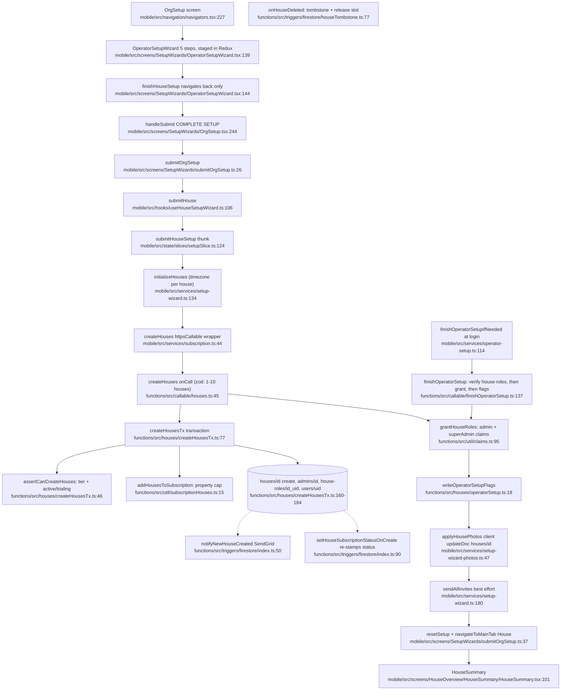
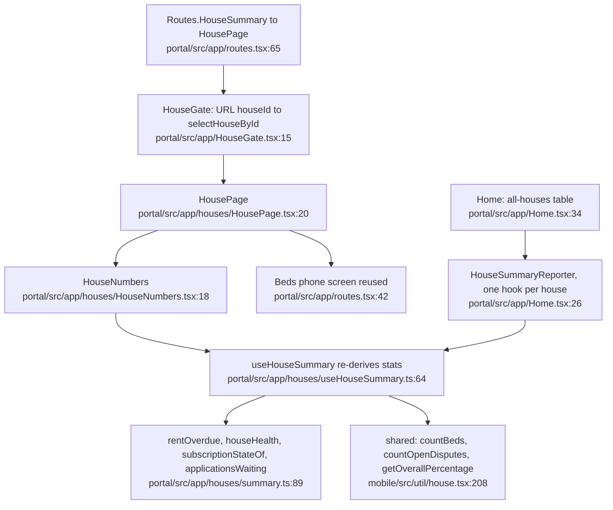

# L1 houses-and-operator-setup

Prefixes: `mobile/` = `regroup/mobile/`, `functions/` = `regroup/functions/`, `portal/` = `regroup/portal/`.

## Happy path: operator setup creates houses (phone → server)

The wizard keeps every edit in Redux (`setupSlice.updateHouseData`, `mobile/src/state/slices/setupSlice.ts:168`). Nothing is saved until OrgSetup's "COMPLETE SETUP". From there, one callable, `createHouses`, does all of the server work in one transaction. Then a fixed post-commit sequence runs: grant claims, then write the onboarding flags. Firestore rules deny client house creates (`regroup/mobile/firebase/firestore.rules:508-509`).

## Portal: house summary (a replacement, not reuse)

`portal/src/app/routes.tsx:65` maps `Routes.HouseSummary` to the portal's own `HousePage`. `Routes.Beds` reuses the phone screen (`routes.tsx:42`).

## Side effects

| Effect                    | Where                                                        | Target                                                                 |
| ------------------------- | ------------------------------------------------------------ | ---------------------------------------------------------------------- |
| Firestore create          | `functions/src/houses/createHousesTx.ts:160`                 | `houses/{id}`, where `id = deriveHouseId(uid, requestKey)`             |
| Firestore set (merge)     | `createHousesTx.ts:172`                                      | `admins/{adminId}`                                                     |
| Firestore set             | `createHousesTx.ts:178`                                      | `house-roles/{houseId}_{uid}` (primary owner)                          |
| Firestore update          | `createHousesTx.ts:180`                                      | `users/{uid}`: `adminId`, `housesOwned`, `subscriptionMetadata.houses` |
| Auth claims               | `functions/src/util/claims.ts:109`                           | `admin[houseId]`, `superAdmin[houseId]`                                |
| Firestore update          | `functions/src/houses/operatorSetup.ts:19`                   | `users/{uid}`: `orgSetupCompleted`, `isAdmin`, `isSuperAdmin`          |
| Trigger update            | `functions/src/triggers/firestore/index.ts:118,122`          | `houses/{id}.subscriptionStatus`                                       |
| Email                     | `index.ts:58`                                                | Regroup admin address (failure is only logged)                         |
| Trigger set / transaction | `houseTombstone.ts:33,81`                                    | `houseTombstones/{id}`, `users/{ownerId}.subscriptionMetadata.houses`  |
| Client Storage + update   | `mobile/src/services/setup-wizard-photos.ts:47`              | `houses/{id}.imageUrl`, `avatar`                                       |
| Client update             | `mobile/src/screens/Beds/hooks/useBedsManagement.ts:133-209` | `houses/{id}.rooms`                                                    |

## Within-lane duplication found

- The phone and the portal each aggregate the summary themselves. They share leaf helpers but differ in what they compute:
  - Health: `getHousePercentage` returns 0 when nothing is scored (`mobile/src/util/house.tsx:150-162`). `houseHealth` returns null in that case (`portal/src/app/houses/summary.ts:111-115`).
  - Overdue rent: `rentOverdue` (`summary.ts:73,89`) is a self-described copy of the phone's `util/paymentDisplay`.
  - Subscription state: `subscriptionStateOf` (`summary.ts:48-64`) mirrors the phone's unexported `evaluateHouseAccess` in `mobile/src/hooks/useSubscriptionGate.ts`.
  - Pending applications: `applicationsWaiting` (`summary.ts:108`) does the same job as the inline filter at `HouseSummary.tsx:131-133`.
  - Open disputes: `useOpenDisputes` (`useHouseSummary.ts:49-58`) does the same job as the phone's `useLiveHouseDisputes` (`HouseSummary.tsx:108`).
- Dead client house-create paths that the rules would reject:
  - `houseService.createHouse` (`mobile/src/services/house.tsx:58`), reached through the `createHouse` thunk (`setupSlice.ts:87-91`, exported as `createHouseSetup` at `state/slices/index.ts:122`) and through `useCreateHouse` (`state/queries/houseQueries.ts:156-160`). The only consumer is the orphan `HouseConfigForm`.
  - `completeSetup` and `updateHouseConfig` (`setupSlice.ts:98-117`) have no screen callers.
- Orphan screens:
  - `mobile/src/screens/HouseConfig/*` has no importers. `.typecheck-baseline:82` still lists it.
  - `mobile/src/screens/HouseChoreOverview/*` is imported only by its own test.
- The selected house is held in four places:
  - `housesSlice.selectedHouseId` (`housesSlice.ts:8,31`), which is canonical
  - the vestigial `housesSlice.selectedHouse` plus its `selectHouse` reducer (`:7,28`), which nothing dispatches
  - the wizard copy `setupSlice.selectedHouse` (`setupSlice.ts:158-185`)
  - the portal URL (`portal/src/app/current-house.ts:13`), reconciled into Redux by `HouseGate.tsx:21-27`
- `subscriptionStatus` is stamped twice at create: once by `createHousesTx.ts:166`, then by the trigger (`index.ts:104-122`). The trigger is redundant whenever the house came from the callable, and the rules forbid any other create.
- The post-commit grant-then-flags sequence is written twice: `houses.ts:55-80` and `finishOperatorSetup.ts:160-171`. The candidate-house list is also written twice: `finishOperatorSetup.ts:32-38` and `:99-104`.
- The creation gate exists on both server and client: `assertCanCreateHouses` (`createHousesTx.ts:46-58`) and `canCreateHouses` (`mobile/src/services/setup-plan-gate.ts:13`). The client version also accepts `cancelling`, so the two can disagree.

## External dependencies

Billing and entitlement (`users.subscriptionMetadata`, `F/util/entitlement.ts`, `subscriptionHouses.ts`); roles and claims (L2); SendGrid (L9); invitations (`setup-wizard-invites.ts`, L2); Storage; timezone lookup.

## Gaps

- The five wizard step screens were not read one by one.
- `organization.ts` / `createOrganization` was not traced.
- `houseInput.ts` and `houseId.ts` were not read.
- `updateHouse` field coverage was not read.
