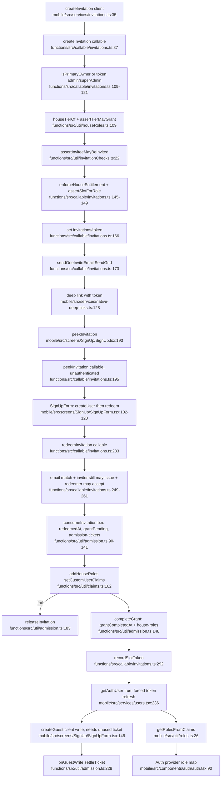
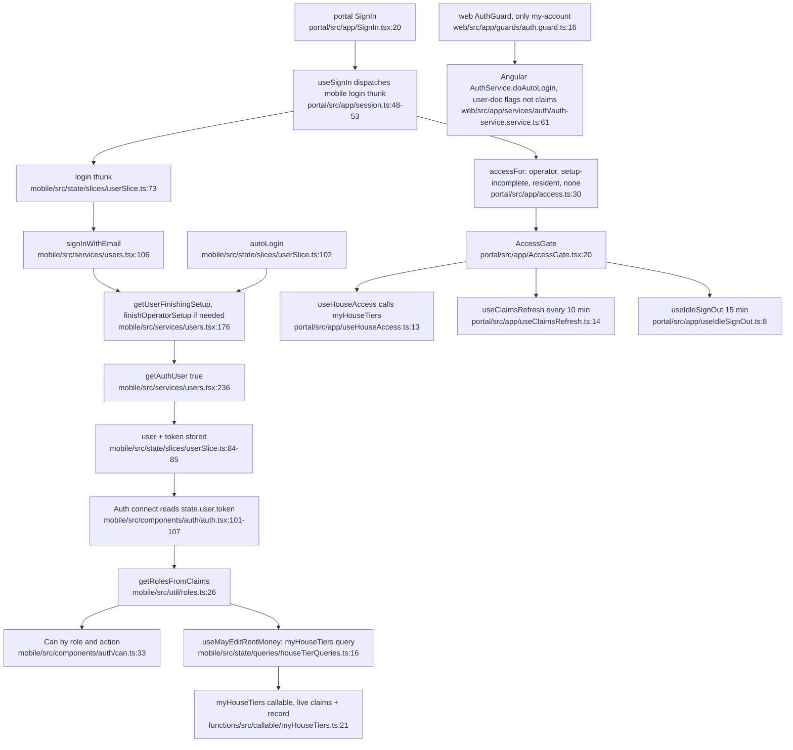
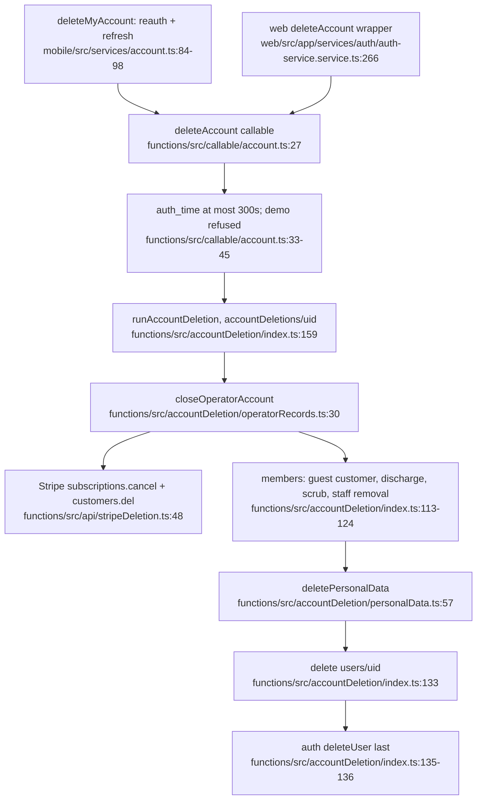

# L2 identity-access-and-roles

Prefixes: `mobile/` = `regroup/mobile/`, `functions/` = `regroup/functions/`, `portal/` = `regroup/portal/`, `web/` = `regroup/web/`.

## Role model

Clients see token claims `guest`, `admin` and `superAdmin`, each a map of the form `{houseId: true}`. Two distinctions exist only in the server-only record `house-roles/{houseId}_{uid}` (`functions/src/util/houseRoleStore.ts:22-32`): manager versus peer leader, and primary owner versus co-owner. The server's tier comes from `tierAndRank` (`functions/src/util/houseRoles.ts:92-101`), which combines live claims (`getUser`) with that record.

## Path (i): invite, redeem, role visible

## Path (ii): login, hydrate, role gate (phone and portal)

The portal reuses the phone's `login` and `autoLogin` thunks (`portal/src/app/session.ts:4,53`) and `getRolesFromClaims` (`portal/src/app/useRoles.ts:2`). Only the session lifecycle is its own.

## Path (iii): deleteAccount (resumable)

## Side effects

| Flow                          | Firestore                                                                                                                                    | Claims                                                                            | Other                             |
| ----------------------------- | -------------------------------------------------------------------------------------------------------------------------------------------- | --------------------------------------------------------------------------------- | --------------------------------- |
| createInvitation              | `invitations/{token}`                                                                                                                        | none                                                                              | SendGrid invite                   |
| redeemInvitation              | `invitations/{token}` (`redeemedAt`, `grantPending`, `grantCompletedAt`), `admission-tickets/{uid}_{houseId}`, `house-roles/{houseId}_{uid}` | `addHouseRoles`                                                                   | slot occupancy                    |
| legacy grant/revoke callables | `house-roles` record before and after; `houses.adminIds` / `superAdminIds` arrayRemove                                                       | `createClaims`, `deleteClaim`                                                     | none                              |
| deleteAccount                 | `accountDeletions/{uid}`, owned houses, `guests` scrubbed into `guest-archive`, many personal collections, `users/{uid}`                     | none (Auth user deleted last)                                                     | Stripe cancel and customer delete |
| operator signup               | none                                                                                                                                         | `potentialSuperAdmin` (from `createOperatorSubscription`, `subscriptions.ts:152`) | none                              |

## Server authority sources (lead b)

| Callable or check                                                                                                                                                           | Authority                                                                                                                                                                     |
| --------------------------------------------------------------------------------------------------------------------------------------------------------------------------- | ----------------------------------------------------------------------------------------------------------------------------------------------------------------------------- |
| `createInvitation`, legacy grant/revoke callables (`functions/src/util/authGuard.ts:70-75`)                                                                                 | Outer gate: the primary-owner record, or the caller's **token** claims, which may be stale. Inner gate: live claims plus record (`assertMayGrantTier`, `assertMayRevokeAll`). |
| `myHouseTiers`, `redeemInvitation` (inviter check)                                                                                                                          | Live claims plus record                                                                                                                                                       |
| `isHouseMoneyStaff` (`functions/src/util/houseAuth.ts:46-54`): `listHousePayments` (`payments.ts:374`), `resolveFailedPayment.ts:43`, `analytics.ts:152`, `payments.ts:183` | **House-doc fields** `adminId`, `adminIds`, `superAdminIds` and `ownerId`, or a `house-roles` tier of owner or manager                                                        |
| `assertHouseAdmin` (`payments.ts:634,808`)                                                                                                                                  | House-doc fields only                                                                                                                                                         |
| `assertHouseMemberFromClaims` (`payments.ts:339,430`)                                                                                                                       | Token claims only                                                                                                                                                             |
| `checkIsMember` (`payments.ts:919`)                                                                                                                                         | House-doc fields, falling back to a `guests` query                                                                                                                            |
| `subscriptions.ts:639`                                                                                                                                                      | `isPrimaryOwner` record                                                                                                                                                       |
| `guestWrite.ts:177`                                                                                                                                                         | `readRoleTier` (record)                                                                                                                                                       |

House-doc fields are the weakest source: a superAdmin can write them, and invited managers are never added to `adminIds`.

## Within-lane duplication found

- **Dead `authSlice`.** `mobile/src/state/slices/authSlice.ts:41` is registered at `mobile/src/state/store.ts:36` and whitelisted at `:56`. Nothing reads `state.auth`, and nothing dispatches `loginSuccess` or `setInvitation`. `userSlice` holds the same `invitation`, `token`, `loggedIn` and `anonymous` state.
- **Two grant orders.**
  - Legacy `auth.ts` writes record, then claims, then record. The sequence is copied three times: `auth.ts:97-106`, `:179-202` and `:325-329`.
  - `redeemInvitation` writes claims, then record (`invitations.ts:285-290`).
  - The legacy `addGuestAuthorization` and `addAdminAuthorization` are reached only from the token-less deep-link branch (`SignUpForm.tsx:121-125,184-187`, `native-deep-links.ts:154-172`), which is marked "kept until Phase F".
- **Two claim-write styles.** `deleteClaim` then `setCustomUserClaims` (`auth.ts:248-257,389-395`) does the same job as `addHouseRoles` / `revokeHouseRoles` (`claims.ts:128,162`). Both are non-atomic read-modify-write.
- **Group-by-house loop** written twice: `auth.ts:280-285` and `auth.ts:359-364`.
- **Invitation role tables** in four places: server `ROLES` (`invitations.ts:57`), `INVITATION_TIER` (`houseRoles.ts:85`), the switch at `invitations.ts:282`, and the client's `InvitationRole` (`mobile/src/services/invitations.ts:4`) together with `SignUpForm.tsx:65-71`.
- **Staff predicate** in two places: `isStaffRole` (`portal/src/app/access.ts:13`) is the same predicate as `isAdmin` (`mobile/src/util/roles.ts:35`).
- **Two admin-removal screens:** `AdminManagement.tsx:133` and `ManagerSettings.tsx:155` both call `removeAdminPrivileges`.
- **Callables with no caller:**
  - `givePotentialSuperAdminPrivilege`: the wrapper at `mobile/src/services/setup-wizard.ts:45-47` is never invoked.
  - `verifyUserEmail`: only a web wrapper exists. It sets `emailVerified` without an inbox check.
- **Orphan `EnhancedAuthService.ts`:** it has no non-test importer, but `architecture.md:78` still lists it as a live service.
- **Separate web login:** the Angular `AuthService` (`auth-service.service.ts:36,61,85,284`) is its own login, signup and session implementation, and it gates on user-doc flags rather than claims.

## External dependencies

- L7: entitlement and slot capacity gate grants. `createOperatorSubscription` grants `potentialSuperAdmin`. Account deletion cancels billing.
- L1: `createHouses` and `finishOperatorSetup` write the primary-owner record and claims.
- L3: `onGuestWrite` settles tickets and revokes claims on departure.
- L6: `isHouseMoneyStaff` and `assertHouseAdmin`.
- L9: SendGrid invites.

## Gaps

- `firestore.rules` was not read.
- Read only partly or not at all: `inviteCapacity.ts`, `entitlement.ts`, the `accountDeletion/*` internals, `EnhancedAuthService.ts`, and the web `AuthService` beyond grep.
- I did not confirm whether `isHouseAdmin` at `syncWeekSummary.ts:137` is the `houseAuth.ts` helper. The signatures differ.
