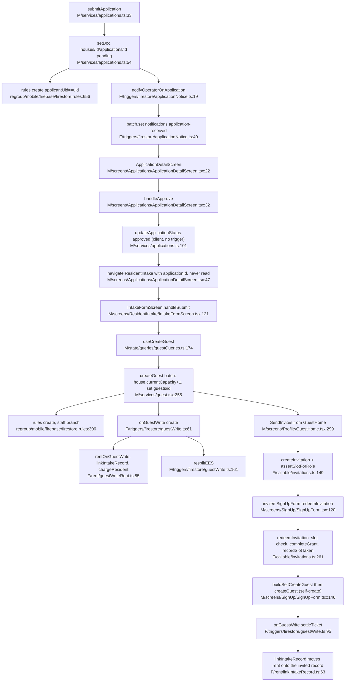
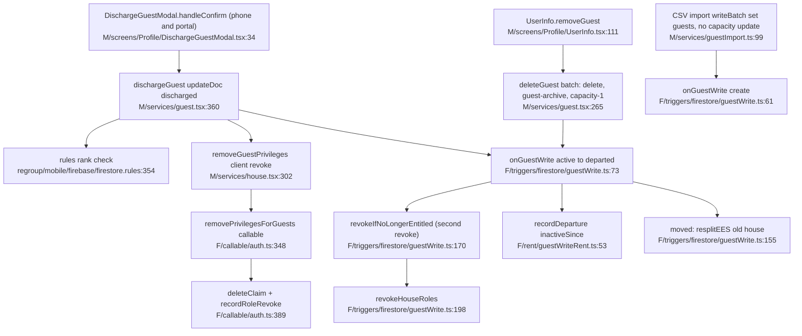

# L3 residents-and-admissions

Prefixes: `M/` = `regroup/mobile/src/`, `F/` = `regroup/functions/src/`, `P/` = `regroup/portal/src/app/`. Rules: `regroup/mobile/firebase/firestore.rules`.

## Path (i): apply → approve → intake → guest record → invite

The approve step forwards an `applicationId`, but the intake screen never reads it (`M/screens/Applications/ApplicationDetailScreen.tsx:47` → `M/screens/ResidentIntake/IntakeFormScreen.tsx:85`). As a result, no record links the guest to the application. Intake creates an accountless guest. Separately, the invitee later self-creates a **second** guest doc, and `linkIntakeRecord` moves the rent history onto it.

## Path (ii): discharge, delete or CSV import → onGuestWrite

## Side effects

| Action                             | Effect                                                                                                                               | Where                                                                            |
| ---------------------------------- | ------------------------------------------------------------------------------------------------------------------------------------ | -------------------------------------------------------------------------------- |
| Apply                              | `houses/{h}/applications/{a}` created; `notifications/{id}` written for each staff member                                            | `M/services/applications.ts:54`, `F/triggers/firestore/applicationNotice.ts:40`  |
| Approve or reject                  | application `status`, `operatorNote`, `reviewedAt` and `reviewedBy` updated; no server reaction                                      | `M/services/applications.ts:101`                                                 |
| Intake / self-create               | `guests/{id}` set, plus a whole-house update that increments `currentCapacity`, done as read-then-write rather than in a transaction | `M/services/guest.tsx:257-260`                                                   |
| CSV import                         | `guests/{id}` set; `currentCapacity` not touched                                                                                     | `M/services/guestImport.ts:99`                                                   |
| Guest create (server)              | ticket settled; `rentAccounts`, `rentCharges` and `rentOwed` set by `chargeResident`; intake record linked; `ees-records` re-split   | `F/rent/guestWriteRent.ts:107-137`, `F/triggers/firestore/guestWrite.ts:296-304` |
| Discharge (client)                 | status changed, then the revoke callable runs; `currentCapacity` **not** decremented                                                 | `M/services/guest.tsx:354-394`                                                   |
| Departure / delete / move (server) | claims revoked, `house-roles` re-derived, `inactiveSince` set, EES re-split                                                          | `F/triggers/firestore/guestWrite.ts:126-161`                                     |

## Within-lane duplication found

- **Six or more client writers to `guests`, none sharing a helper.** Only Firestore rules validate the writes (`firestore.rules:306-315`).
  - `createGuest` (`M/services/guest.tsx:255`), shared by intake and self-create
  - CSV import (`M/services/guestImport.ts:98-122`), which builds its own field list, uses its own email regex and does not lowercase emails
  - `phaseAdvancement.ts:158`
  - `users.tsx:303`
  - `house.tsx:398,404`, where `updateHouseBatch` is unused
  - `dischargeGuest` and `deleteGuest`
- **Claim revoke on discharge happens twice, under different checks.**
  - The client callable path: `M/services/guest.tsx:385` → `F/callable/auth.ts:348`, checked by `assertMayRevokeAll`.
  - The trigger path: `F/triggers/firestore/guestWrite.ts:126-129,198`, checked by `entitlingDocs`.
  - The callable schema requires `userId` (`F/callable/auth.ts:43-48`). For an accountless resident, discharge is therefore likely to report `access-not-revoked` (`guest.tsx:389-392`). **Unverified.**
- **Two definitions of an active guest.**
  - Server: `isActiveGuestDoc` (`F/util/guestMembership.ts:100`), meaning no `moveOutDate` and a status that is absent or `active`.
  - Clients: `status !== 'discharged'` (`M/screens/GuestList/GuestList.tsx:211-219`, `P/residents/rows.ts:21-22`).
- **Two resident-cap implementations:** `F/util/residentCapacity.ts:57-100`, used only on the invitation path, and `F/callable/subscriptions.ts:566` (`withinResidentCap`). Accountless residents never count against the cap until they redeem an invite.
- **Two "capacity" numbers.** `house.currentCapacity` (a bed count kept by the client) drifts, because discharge and CSV import never change it. It is a different number from the tier occupancy count `subscriptionMetadata.houses[h].numberOfGuests`.
- **Delete logic in two places:** client `deleteGuest` (`M/services/guest.tsx:265-300`) and the server's account-deletion mirror (`F/accountDeletion/memberRecords.ts:77`).
- **House search duplicated, one copy dead.** The client geohash query (`M/services/house.tsx:114,164`) does the same job as the dead server `getNearbyHouses` (`F/api/firestore.ts:117`). `getGeohashRange` exists in both `M/util/geolocation.ts:48` and `F/util/location.ts:89`.
- **Dead code:**
  - Redux guest list state (`M/state/slices/guestsSlice.ts:6-65`, where `cacheGuests` is never dispatched). React Query `useGuests` is the real source.
  - The unrouted `CreateGuest` and `GuestUpdate` screens. `CreateGuestForm.tsx:5` imports a `addGuest` that does not exist.
- **The portal shares the data layer but forks the presentation.**
  - Shared via `@mobile/`: `useGuests`, `useGuest`, `DischargeGuestModal`, `UserInfo`, and the intake and application screens.
  - Forked: the `ResidentTable` and `ResidentRecord` components, and the discharged-resident filter.

## External dependencies

- L6: rent (`chargeResident`, `linkIntakeRecord`)
- L2: `admission`, claims, `house-roles`
- L7: tier caps
- L8: EES re-split
- L9: notifications
- L4: `phaseAdvancement` writes `guests`

## Gaps

- Screens not read: `ApplyScreen`, `ApplicationStatusScreen`, `GuestImportScreen`, and the body of `GuestHome`, so the staff profile-edit path was not located.
- `invitations.ts` bodies and the `Guest` entity defaults were not read.
- The remaining guest rules after `:374` were not read.
