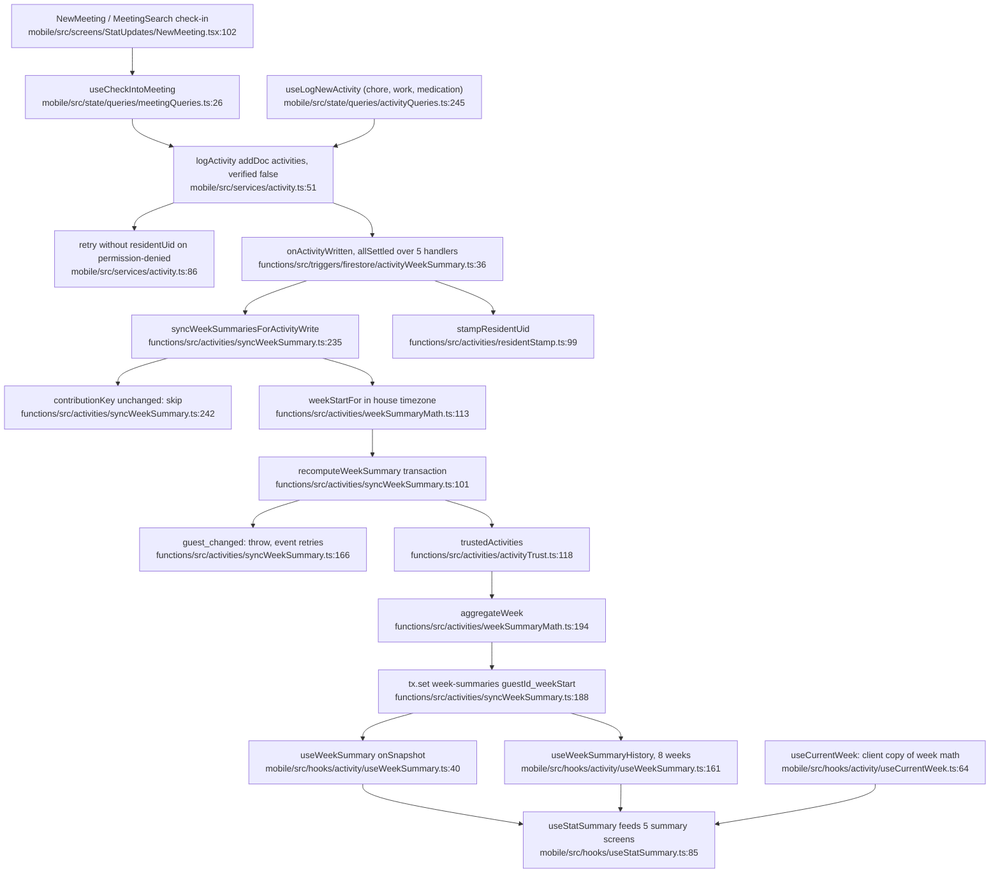
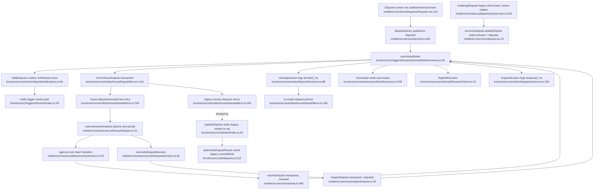

# L4 activities-and-disputes

Prefixes: `mobile/` = `regroup/mobile/`, `functions/` = `regroup/functions/`.

The server owns every derived value. Clients write only to `activities/{id}`. One trigger, `onActivityWritten`, then fans out to five handlers: week summary, dispute notification, house-dispute mirror, resident stamp, and self-decision flag.

## Path (i): log an activity, then read it in the summary UI

## Path (ii): dispute raised, decided, then reopened

## Side effects

| Actor                                                          | Path                                                                                                             | Effect                                                               |
| -------------------------------------------------------------- | ---------------------------------------------------------------------------------------------------------------- | -------------------------------------------------------------------- |
| Client log / update / soft-delete / dispute / resolve / reopen | `activities/{id}`                                                                                                | create or update                                                     |
| `recomputeWeekSummary`                                         | `week-summaries/{guestId}_{weekStart}`                                                                           | set (merges onto the previous value)                                 |
| `stampResidentUid`, `onGuestLinkedRestamp`, `flagSelfDecision` | `activities/{id}.residentUid` / `.flaggedForReview`                                                              | update                                                               |
| `notifyDispute`                                                | `notifications/dispute_{eventId}_{uid}`                                                                          | create; the `notify` trigger then sends the push                     |
| `mirrorHouseDispute`                                           | `activities/{id}/dispute-decisions/*`, `dispute-archive/*`, `house-disputes/{houseId}`, `houses/{id}.disputes.*` | create / set / update                                                |
| `advanceGuestPhase` (client)                                   | `guests/{id}.phase`                                                                                              | update                                                               |
| `advanceRotation` (client)                                     | `choreRotations/{houseId}`                                                                                       | update                                                               |
| `weeklyTransfers`                                              | `guests.currentWeekId`, `week-summaries` (create if missing), `houses/{id}` health                               | update / create                                                      |
| `updateDisputes` (legacy)                                      | `houses`, `guests`, `disputes/{id}`                                                                              | transaction; acts only on guests that still carry legacy week fields |

## Within-lane duplication found

- **Dispute model: the new path is live, the old one has not been removed.**
  - Live path: clients write the activity and read `house-disputes`.
  - Legacy server code still runs daily: `updateDisputes` and `functions/src/util/disputes.ts`. It iterates the `houses.disputes` mirror that the new model writes (`houseDisputeMirror.ts:245`), then bails for modern guests (`util/disputes.ts:213`).
  - Legacy client code still exists: `challengeDispute` → `services/dispute.updateDispute` (`mobile/src/services/dispute.tsx:24`). Its button is hidden, but it is reachable through modal type `'confirm'` (`useBaseActivityScreen.ts:222`).
  - `createDispute` (`dispute.tsx:36`) has no caller.
- **Week-stat model: `week-summaries` is the only live store.**
  - `guest-weeks` (`weeksCollection`, `functions/src/api/firestore.ts:16`) has no importer.
  - `weeklyTransfers` no longer rolls stats over. It still advances `guest.currentWeekId` and recomputes house health.
- **Week and date math is implemented in six places:**
  1. `weekStartFor` (`functions/src/activities/weekSummaryMath.ts:113`). This is the authoritative one: house timezone, Monday start.
  2. `getWeekStart` (`mobile/src/hooks/activity/useCurrentWeek.ts:35`). It declares that it must match the server and carries its own copy of the timezone resolver.
  3. `getStartOfWeekInTimezone` (`mobile/src/util/dateWithTimezone.ts:38`). This uses a **Sunday** start (the date-fns default) and is used only by orphan screens.
  4. `getCurrentWeekStart` (`functions/src/util/week.ts:33`). This uses a **UTC** Monday and sets `guest.currentWeekStartDate`, which can disagree with the house-local week on Sunday evenings in US time zones.
  5. `buildWeekId` (`functions/src/util/week.ts:12`), which does the same job as `summaryDocId` (`weekSummaryMath.ts:161`).
  6. A device-local Sunday for chore rotation, duplicated in two places (`mobile/src/services/choreRotation.ts:14`, `mobile/src/hooks/useAutoAdvanceRotation.ts:7`).
  - Rent also imports `weekSummaryMath` (`functions/src/rent/anchor.ts:6`), so any consolidation has to keep that interface working.
- **Two `useWeekSummary` hooks:**
  - The React Query version (`mobile/src/state/queries/activityQueries.ts:199`), taking `(guestId, weekStart, enabled)`.
  - The `onSnapshot` version (`mobile/src/hooks/activity/useWeekSummary.ts:40`), taking `(guestId, houseId, weekStart)`.
  - `getWeekSummaryOnce` (`useWeekSummary.ts:118`) does the same job as `getWeekSummary` (`activity.ts:306`).
- **Two meeting check-in paths:**
  - The Redux thunk `checkIntoMeeting` (`mobile/src/state/slices/meetingsSlice.ts:66-103`) swallows a failed save.
  - `useCheckIntoMeeting` throws on a failed save. It is the live one.
- **Dead client duplicates of server work:**
  - `updateHouseDisputes` (`useBaseActivityScreen.ts:237-267`)
  - `useDisputeActivity` and `useResolveDispute` (`activityQueries.ts:369,392`)
  - `amountOfDisputeProps` (`mobile/src/util/guest.tsx:483`), which also double-counts
  - `countOpenDisputes` (`mobile/src/util/house.tsx:237`). L1 reports this as used by the portal summary, so it needs a re-check before removal.
  - The `DisputeNotification` entity (`mobile/src/entities/Notification.tsx:32-79`), a copy of the server message text
- **Phase advancement runs only on the client.** It is a client `updateDoc` of `guests.phase` (`mobile/src/services/phaseAdvancement.ts:154`). No server code validates it. `functions/src/util/phase.ts` holds only templates.
- **Orphan screens:**
  - `mobile/src/screens/HouseChoreOverview/*`
  - `HouseSettings/ChoreRotationSetupScreen.tsx`
  - Because of these orphans, no live UI can create a chore rotation (`setRotationOrder`, `choreRotation.ts:35`).

## External dependencies

- L3: fields on `guests` and `houses`
- L2: admin claims via `claimsHouseAdminCheck`
- L9: `notify` trigger
- L8: the compliance export reuses `activityTrust` and `weekSummaryMath`
- L6: rent imports the week and time-zone helpers
- Portal: imports `useLiveHouseDisputes` and the `Disputes` screen

## Gaps

- The bodies of the trust, stamp and self-decision modules were not read.
- The rules were not read, so it is unknown whether `guests.phase` writes are restricted to admins.
- `checkPhaseCompliance` was not read.
