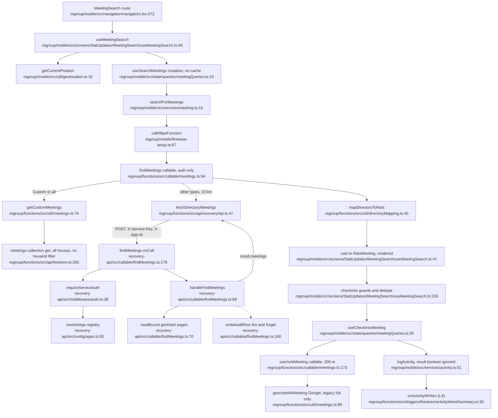

# L5 meeting-directory (12-step meetings, through recovery-api)

Here, "meeting" always means a 12-step meeting. Prefixes: `regroup/mobile/src` (phone), `regroup/functions/src` (Regroup functions), `recovery-api/src` (the shared API).

For Regroup, recovery-api provides exactly one thing: the `findMeetings` read of the shared `directoryMeetings` store. Nothing in Regroup calls referrals, users or identity (grep over `regroup/`).

## Paths (i) search and (ii) check-in

`CHKMUT` goes to both `FAT` and `LOGACT`. The boolean `FAT` returns never decides whether `LOGACT` runs.

## Side effects

| Where                  | Effect                                                                                                                                                                                                               |
| ---------------------- | -------------------------------------------------------------------------------------------------------------------------------------------------------------------------------------------------------------------- |
| Regroup → recovery-api | `POST ${RECOVERY_API_BASE_URL}/findMeetings`. Headers: `X-Service-Key`, `X-App-Id: phoenix-cleanhouse`, `X-User-Uid`, `X-User-Email`. No timeout, retry or cache (`regroup/functions/src/api/recoveryApi.ts:62-73`). |
| recovery-api read      | `directoryMeetings`, paged range reads on `location.geohash`, 500 per page                                                                                                                                           |
| recovery-api write     | `directoryMeetingRequests` audit row: hashed uid and a location coarsened to about 1 km                                                                                                                              |
| Regroup functions read | Entire Regroup `meetings` collection via the Admin SDK (`regroup/functions/src/api/firestore.ts:21,250`)                                                                                                             |
| Regroup functions HTTP | Google Geocode, only when `meetingAddress` is non-empty; effectively legacy                                                                                                                                          |
| Phone write            | `activities` with `verified: false` (`regroup/mobile/src/services/activity.ts:71,85`)                                                                                                                                |

## Findings beyond duplication (to verify)

- **Custom meetings leak across houses.** `getCustomMeetings` reads every house's custom meetings with the Admin SDK and applies no `houseId` filter (`regroup/functions/src/util/meetings.ts:74-92`, `api/firestore.ts:250`). The callable takes no `houseId` (`callable/meetings.ts:20-37`). The client rule that scopes reads to the meeting's house (`regroup/mobile/firebase/firestore.rules:848`) is bypassed, so `houseId` and `addedBy` from other houses can be returned to any signed-in user.
- **The attendance check is never enforced.** The `userIsAtMeeting` result is ignored by `useCheckIntoMeeting` (`meetingQueries.ts:41-63`), by `NewMeeting.tsx:416` (which passes `userLocation: null`), and by the deprecated thunk. Every check-in is recorded whatever the distance.

## Duplication found

- **Meeting shapes and mapping hops.** Data passes through these forms between the source and the screen:
  - recovery-api `DirectoryMeeting` (`recovery-api/src/entities/DirectoryMeeting.ts:31`)
  - a hand-synced wire copy in Regroup functions (`regroup/functions/src/entities/DirectoryMeeting.ts:24`)
  - the functions `RatsMeeting` (`entities/Meeting.ts:3`, with type `'CUSTOM'`)
  - the phone `RatsMeeting` (`regroup/mobile/src/entities/Meeting.tsx:22`, with type `'Custom'`), reached by a cast only
  - The type enum differs across three files (`callable/meetings.ts:24`, `MeetingFilterForm.tsx:13`, `entities/Meeting.tsx:67-73`). `MeetingSearchCriteria` is defined twice.
  - `AAMeeting` and `NAMeeting` are dead.
- **Day-name normalization** in `regroup/functions/src/util/directoryMapping.ts:16` duplicates `recovery-api/src/lib/meetings/identity.ts:46,69`. A third copy is in homegroups.
- **Geohash and distance code:**
  - `getGeohashRange` is copy-pasted in `regroup/mobile/src/util/geolocation.ts:48-69` and `regroup/functions/src/util/location.ts:89-110`. It is used only for house search.
  - `regroup/functions/src/util/geohash.ts` (210 lines, a hand port of geofire) is entirely dead.
  - recovery-api uses `geofire-common`. Its `haversineKm` (`lib/meetings/meetingSweep.ts:90`) sits beside geofire's `distanceBetween`.
- **Dead meeting sources in Regroup functions:**
  - `getAAMeetings` (meetingguide.org)
  - `getCelebrateRecoveryMeetings`
  - `getNAMeetings` / `getNaMeetings` (`na-meetings` collection)
  - `getMeetingsWhere`, `reverseGeocode`, `geocode`, `getTimezone`
  - These are in `regroup/functions/src/api/api.ts:26-103` and `api/firestore.ts:246-252,384-398`.
- **Check-in logic in two places:** the live `meetingQueries.ts:26-66` and the deprecated `meetingsSlice.ts:66-103`. The meeting day/time rules are also written twice: `useMeetingSearch.ts:187-205` and `regroup/mobile/src/util/meeting.ts:49-61`.
- **Zero-coordinate fallback in three places:** `util/meetings.ts:29,66` and `regroup/mobile/src/util/meeting.ts:36-37`.
- **recovery-api directory refresh.** `refreshDirectory.ts` is not exported and `refreshSlice` has no caller. The directory is filled only by the manual scripts in `recovery-api/scripts/`, which is an owner decision.

## External dependencies

- L4: `logActivity` and `onActivityWritten`
- L3: house and guest selection
- Config: secrets `RECOVERY_PLATFORM_API_KEY` and `GOOGLE_MAPS_API_KEY`

## Gaps

- The recovery-api source mappers and the `meetingSync`/`naSync` bodies were not read.
- `MeetingResultsList` was not read.
- Live data in `meetings` was not checked.
