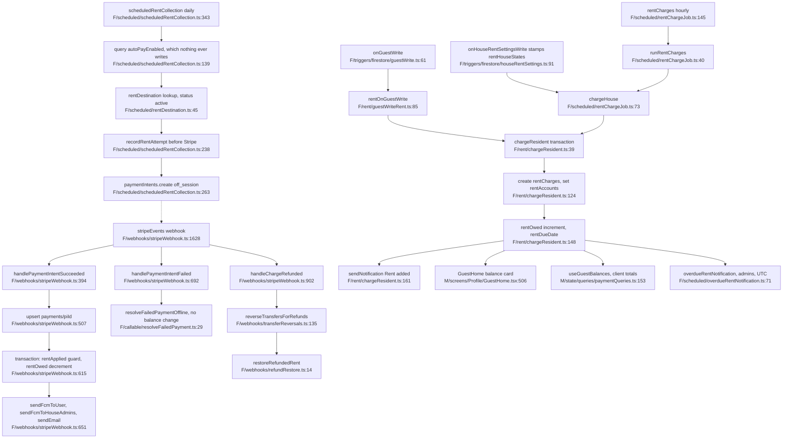
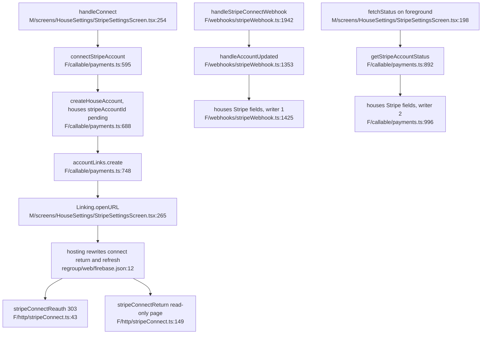
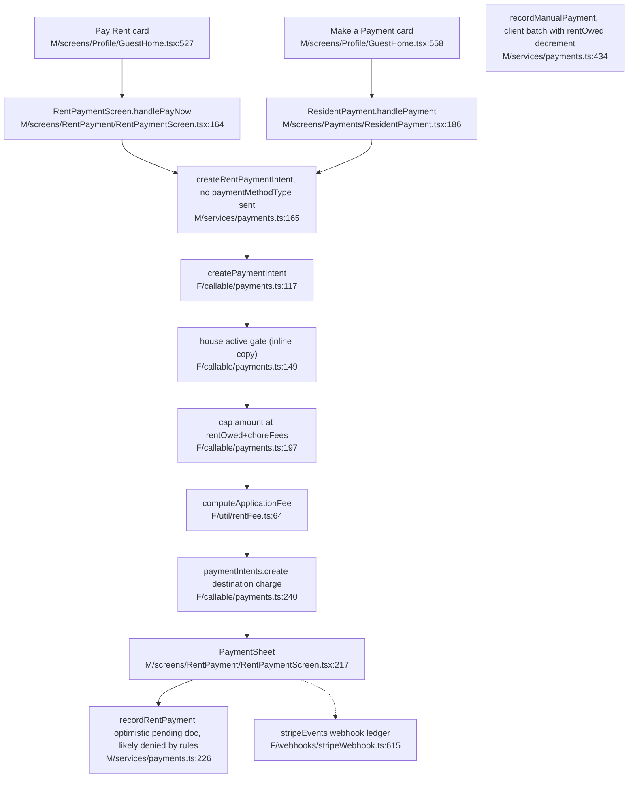

# L6 rent-and-resident-payments

Prefixes: `F/` = `regroup/functions/src/`, `M/` = `regroup/mobile/src/`. Money path.

## (i) Accrual → autopay → webhook ledger → resident view

## (ii) Operator Connect onboarding

## (iii) Resident one-off payment

## Side effects

See the lane report's table, summarized here:

- **`chargeResident`** writes in one transaction:
  - `rentCharges`
  - `rentAccounts`
  - `guests.rentOwed` and `rentDueDate`

  It then sends a push.

- **Webhook success** writes:
  - `payments/{piId}`
  - `rent-collection-attempts`
  - `guests.rentOwed` (decrement)
  - `webhookEvents`

  It then sends two pushes and an email.

- **Refund**: reverses the transfer, then increments `rentOwed` back.
- **Connect**: writes the house Stripe fields from two places, the webhook and the polling callable.
- **Stripe calls**:
  - `paymentIntents.create` and `retrieve`
  - `paymentMethods.retrieve`
  - `accountLinks.create`
  - `transfers.createReversal` and `create`
  - `charges.list` on the connected account

## Findings beyond duplication (to verify)

- **Autopay is dead.** Nothing writes `autoPayEnabled` or a guest `stripeCustomerId` (`F/scheduled/scheduledRentCollection.ts:21-22`). `updatePaymentInfo` attaches the card to the operator's own customer (`F/callable/payments.ts:522`), and no client calls it. The whole `scheduledRentCollection` job matches no one.
- **The resident's optimistic `recordRentPayment` write is probably denied.** The rule for creating `payments` requires `isAdmin` (`regroup/mobile/firebase/firestore.rules:678-681`). The error is only logged (`RentPaymentScreen.tsx:256-261`).
- **Chore fees end up in the wrong field.** Residents pay `rentOwed + choreFees`, but the webhook takes the whole amount off `rentOwed` (`F/webhooks/stripeWebhook.ts:627`). `rentOwed` goes negative and `choreFees` never falls. `rentRoiMetrics.outstandingCents` counts rent only, so it drifts.
- **ACH can't be selected.** The phone never sends `paymentMethodType` (`M/services/payments.ts:182-190`), so the server defaults to card (`F/callable/payments.ts:133`).
- **Unreachable screens:** `PaymentWebView` and `BalanceDashboard` are registered as routes but nothing navigates to them.
- **`overdueRentNotification` is loose.** It scans every guest with `rentOwed > 0` (discharged ones included) using UTC dates, and puts the resident's name in the push body.

## Within-lane duplication found

- **Stripe clients:** three are constructed in deployed code: `F/util/stripe.ts:11`, the lazy Proxy at `F/api/stripe.ts:23`, and an inline one at `F/scheduled/scheduledRentCollection.ts:116`. Three more are in scripts. All share the pin in `F/util/stripeApiVersion.ts`.
- **Writers of `rentOwed`** (refutes "chargeResident is the only writer"):
  - Accrual: `chargeResident.ts:148`
  - Transfer: `linkIntakeRecord.ts:206,215`
  - Payment: `stripeWebhook.ts:627`
  - Refund: `refundRestore.ts:37`
  - Manual payment on the client: `M/services/payments.ts:477`
  - Manager edit on the client: `M/services/guest.tsx:88`, enforced by the rules at `firestore.rules:425-449`
  - Initialization: `guestImport.ts:108`
  - Scripts
  - `F/scheduled/rentAttempts.ts:17-19` still says "no rent accrual job"; that comment is stale.
- **Destination and "active" gate:** `F/callable/payments.ts:149,270` and `F/scheduled/rentDestination.ts:45-47`, plus re-checks on the phone (`RentPaymentScreen.tsx:143`, `GuestHome.tsx:510`).
- **Amount and idempotency rules:** one-off payments use the day-bucket key and the `rentOwed + choreFees` cap. Autopay uses the in-flight attempts ledger and charges `rentOwed` only. Neither path accounts for the other, so a double payment is possible but latent while autopay is dead.
- **Two pay screens:** `RentPaymentScreen.tsx:164-288` and `ResidentPayment.tsx:186-277`. Each wraps Stripe in its own require shim. The reminder deep-links to the free-amount screen.
- **Two writers of the Connect status sync:** `F/callable/payments.ts:996-1003` and `F/webhooks/stripeWebhook.ts:1425-1431`, with different field sets. The "closed means disconnected" branch is also duplicated: `payments.ts:959-966` and `stripeWebhook.ts:1409-1423`.
- **Two webhook endpoints dispatch the same Connect events:** `account.updated` and `payout.failed` at `stripeWebhook.ts:1849,1855` and again at `:2042,2057`. They are deduplicated through the shared `claimEvent`.
- **Balance and aging are computed in four places with different definitions:**
  - `useGuestBalances`, which floors at 0 and includes chore fees
  - `PaymentDashboard.tsx:245-259`
  - `BalanceDashboard.tsx:108-113`
  - `rentRoiMetrics` (`F/callable/analytics.ts:268-281`): rent only, with no floor

  "Overdue" also has two meanings: days since the last payment, versus past `rentDueDate`.

- **Rent push senders:** four resident-facing money channels go through three senders (`sendNotification`, inline `sendFcmToUser`, and the local notifee reminder). The client reminder (`M/services/notifications/rentReminder.ts:96`) assumes a Monday due date and ignores `rentDueDate`.

## External dependencies

- L7: shared webhook infrastructure (`claimEvent`, `verifyStripeWebhook`), `sendFcmToUser`, `tierAllows` for ROI, and `api/stripe.ts`
- L2: `houseAuth`
- L3: `linkIntakeRecord` and `onGuestWrite`
- L9: senders
- Account deletion

## Gaps

- `rentAttempts.ts` from line 80 onward was not read.
- The Connect account status and lifecycle internals were not read.
- The rent period math (`anchor`, `chargeRule`, `rate`, `period`) was not read.
- The dispute-closed webhook case was not read.
