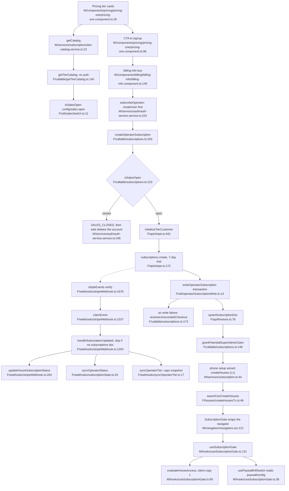
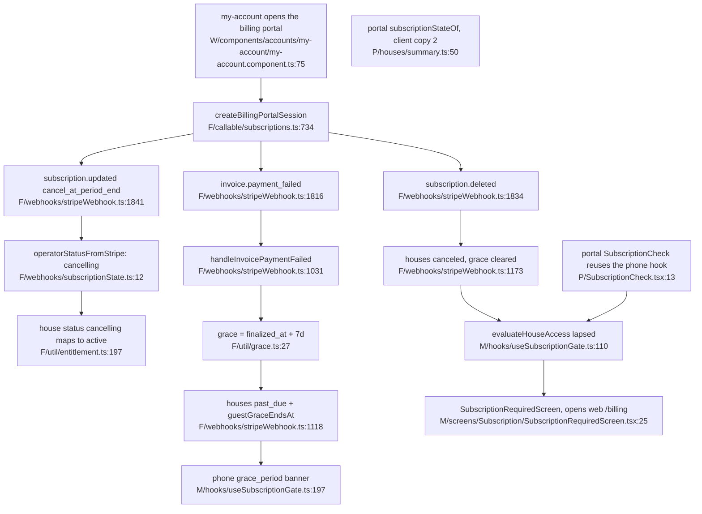
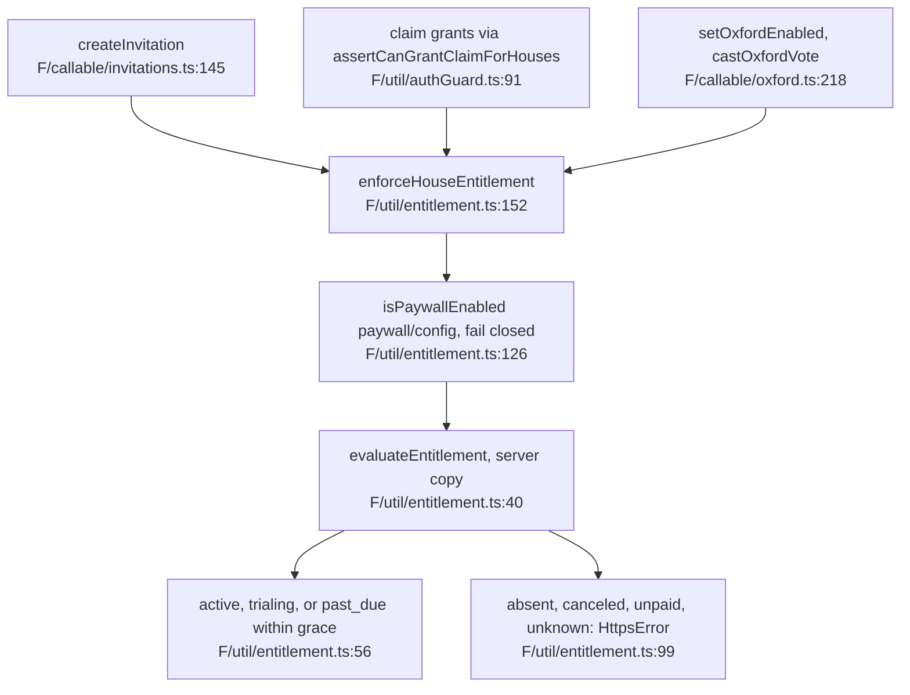

# L7 operator-billing

Prefixes: `F/` = `regroup/functions/src/`, `M/` = `regroup/mobile/src/`, `W/` = `regroup/web/src/app/`, `P/` = `regroup/portal/src/app/`. Money path.

Only four callables have a live client caller: `createOperatorSubscription` (from the web), `getTierCatalog` (web), `createBillingPortalSession` (web) and `createHouses` (phone). The web also reaches `deleteAccount`, through `cleanupOrphanedAccount`. Six callables have no client caller anywhere: `cancelUserSubscription`, `reactivateOperatorSubscription`, `sendConfirmationEmail`, `updateSubscriptionGuests`, `updateSubscriptionHouses` and `applyBundleDiscount`. Operators cancel or change plans in the Stripe billing portal.

## (i) Web tier pick → checkout → webhook → phone unlocks

## (ii) Cancel, payment failure or grace → the gate locks

## (iii) Server entitlement on a gated callable

## Side effects

- **Checkout:**
  - Stripe calls `customers.create`, then card validation (the customer is deleted if validation fails), then `subscriptions.create`.
  - It writes `users/{uid}.subscriptionMetadata` in a transaction, then `subscriptions/{subId}`.
  - It sends an admin email and sets the `potentialSuperAdmin` claim.
- **Webhook:**
  - It writes `webhookEvents`, `subscriptions/{id}`, the houses' `subscriptionStatus` and `guestGraceEndsAt`, and the `status` and tier caps in `users.subscriptionMetadata`.
  - It sends five kinds of push.
- **Catalog:** `prices.retrieve` is called 12 times; the result is cached for an hour.
- **Status-change email:** `sendSubscriptionUpdateEmail` emails the admin on every `subscriptionMetadata.status` change.

## Findings beyond duplication (to verify)

- **A. Reactivation silently moves annual plans to monthly.**
  - `reactivateSubscription`'s tier branch calls `resolveTierPriceId(houseType, tier)` and lets the interval default to `"month"` (`F/api/stripe.ts:212-235`).
  - It also drops `billingInterval`, `houseType`, `tier` and the trial from what it sends.
  - The callable has no client caller today, so this is reachable only from e2e.
- **B. Lost-update race on `users.subscriptionMetadata`.**
  - `updateUser` replaces the whole nested map (`F/api/firestore.ts:236-238`).
  - The callables read the map, spread it and write it back without a transaction: `subscriptions.ts:463,518,580` and `residentCapacity.ts:121`.
  - The webhook writes the same map, but with transactions and dotted paths. A webhook update that lands between a callable's read and write can be overwritten.
- **Closed sales loop the sign-up.** When sales are closed, the web still creates the Firebase account, checkout then fails, and the web deletes the account again. The page never reads `salesOpen` or `trialDays` from the catalog, and its CTA always says "Start Free Trial".
- **Stale docs:**
  - The comment at `entitlement.ts:107-110` says the rules deny the client read of `paywall/config`. They allow it (`regroup/mobile/firebase/firestore.rules:722-725`).
  - `functions/CLAUDE.md` and `.claude/rules/regroup-paywall.md` say "Phase A grants absent status". The code denies it (`entitlement.ts:52-54`).
  - `web/CLAUDE.md` gives the wrapper count as nine with three reachable. It is ten with four reachable.
  - `regroup/CLAUDE.md` says the quantity callables are "gone". They are still exported.

## Within-lane duplication found

- **Legacy two-item billing.**
  - Dead functions in `F/api/stripe.ts`: `createSubscription:115`, `initializeSubscription:395`, `initializeCustomer:423`, `createItemsFromMetadata:176`, `updateHouseSubscriptionAmount:330`, `updateGuestSubscriptionAmount:337`, `updateSubscriptionItem:298`, `getSubscriptionItem:287`, `updateSubscriptionMetadata:487` and `HOUSE_PRICE_ID:38`.
  - Reachable only for tier-less subscriptions, and none exist: `getBundleCoupon`, `applyBundleDiscountToSubscription` and `removeBundleDiscount`.
  - The legacy branch of `reactivateSubscription` (`:237-259`) cannot run.
  - Unreachable blocks inside live code: `subscriptions.ts:336-390`.
  - The legacy status model in `F/api/firestore.ts:146-201`.
- **Three copies of the entitlement ladder:**
  - Server: `F/util/entitlement.ts:40-76`
  - Phone: `M/hooks/useSubscriptionGate.ts:90-111`
  - Portal: `P/houses/summary.ts:50-64`

  They disagree in two cases:
  - Absent status is denied on the server but treated as loading on the phone.
  - A `canceled` house with leftover grace is allowed on the phone but denied on the server. Leftover grace on a `canceled` house is possible because `accountDeletion/operatorRecords.ts:46` and the migration script set `canceled` without clearing it.

- **Tier data defined in many places:**
  - `F/config.ts:130-228`, which is the source of truth
  - A re-declared shape in `tierPricing.ts:5-24`
  - A web type duplicate in `W/entities/TierCatalog.ts`
  - The web's hard-coded trial length (`W/components/pricing/order-summary/order-summary.component.ts:4`) and highlighted tier
  - A **persisted per-operator snapshot of caps** (`maxResidents`, `maxProperties`), which the cap checks read instead of config
  - The list of 12 price env-var names, repeated across five files
- **Many writers of subscription state:**
  - `users.subscriptionMetadata`: 10 or more writers.
  - The houses' `subscriptionStatus`: 7 writers, including `createHousesTx` and then the create trigger again.
  - Status is spelled three ways: `cancelling` on the user doc, `active` on the subscriptions doc, and `active` on houses.
  - The webhook's `HouseSubscriptionStatus` union (`stripeWebhook.ts:251`) is a separate type from the one in `entitlement.ts:164`.
- **Occupancy writers:** the dead `updateSubscriptionGuests` / `updateSubscriptionHouses` do the same jobs as `recordResidentAccepted` (`residentCapacity.ts:110`), `createHousesTx.ts:145` and `onHouseDeleted`.
- **Web account URL from two sources:** hard-coded in `M/screens/SubscriptionHandler/SubscriptionHandler.tsx:22-23` and taken from env in `SubscriptionRequiredScreen.tsx:22-25`.
- **Web callable wrappers:** six of the ten are unreachable. `SubscriptionUpdateModal` is an orphan.

## External dependencies

- L1: `createHouses`
- L2: invitations and claims
- L6: shared webhook infrastructure and `api/stripe.ts`
- L8: Oxford entitlement and `tierAllows`
- L9: senders
- Account deletion: `closeOperatorBilling`

## Gaps

- `closeOperatorBilling` internals were not read.
- The grace and expired-grace screen bodies were not read.
- The list of webhook events registered on the deployed endpoint was not checked.
