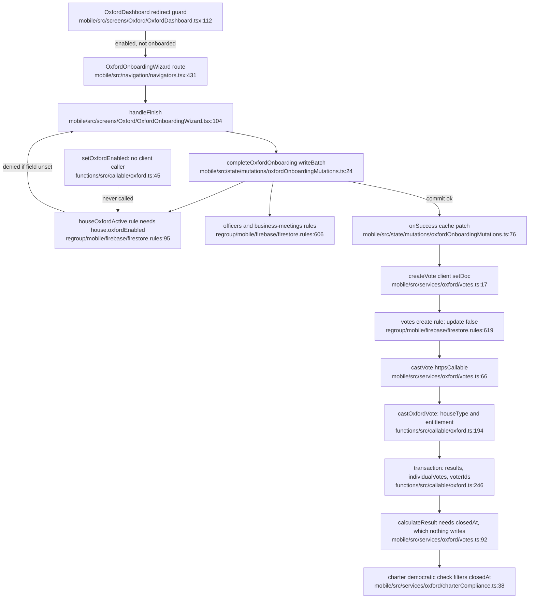
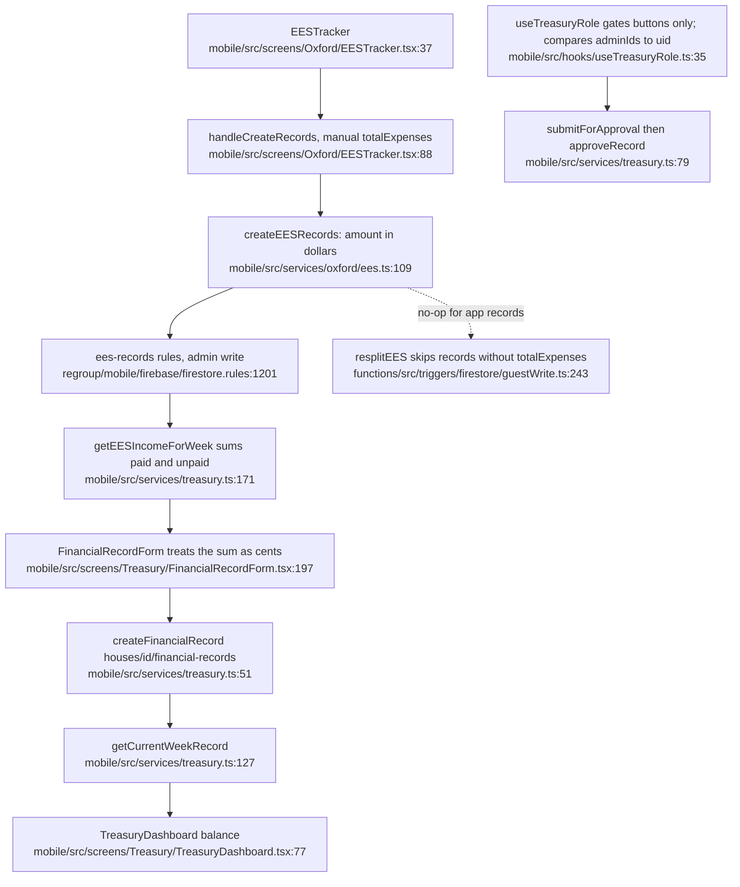
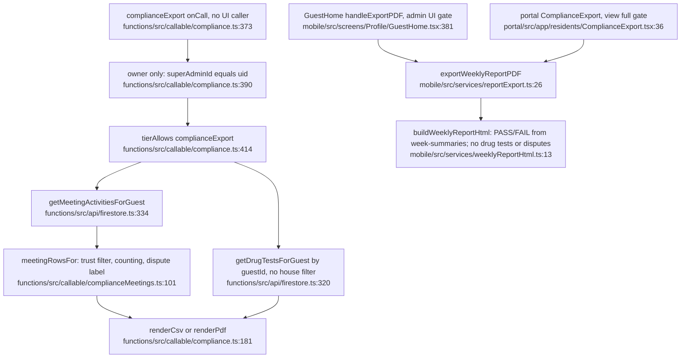
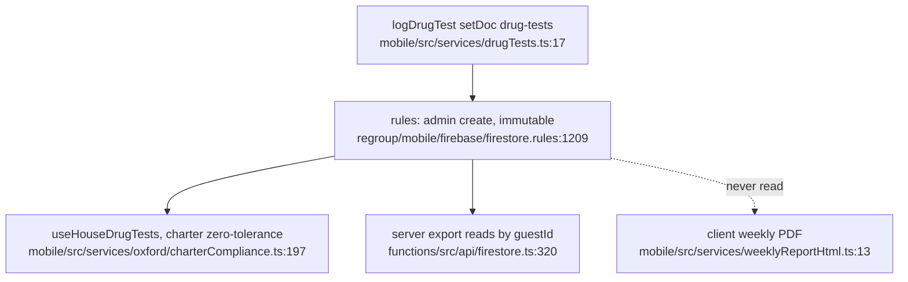

# L8 oxford-and-compliance

Prefixes: `mobile/` = `regroup/mobile/`, `functions/` = `regroup/functions/`, `portal/` = `regroup/portal/`. A "house meeting" is an Oxford business meeting, not a 12-step meeting.

## (i) Oxford onboarding → enabled → vote cast → result

## (ii) EES and treasury → balance

## (iii) Compliance export: two unrelated paths

## (iv) Drug tests

The documents flow is clean. Bytes are read only through `getDocumentLink`, which returns a v4 URL valid for 15 minutes (`functions/src/callable/documentLinks.ts:26`); the storage rules deny direct reads.

## Findings beyond duplication (unverified against live data)

1. **The Oxford rules gate may be dead.** `houseOxfordActive()` (`firestore.rules:95-99`) requires `houses/{id}.oxfordEnabled`. No production code writes that field:
   - `createHousesTx.ts:167` writes `houseType`.
   - `setOxfordEnabled` writes `houseType` and `users.subscriptionMetadata.oxfordEnabled`.
   - `houseInput.ts:24` strips the field.
   - Only Maestro seeds write it.

   If this holds, the onboarding batch and every officer, house-meeting and vote write are denied for a real house.

2. **Votes never close.** Nothing writes `votes.closedAt` or `passed`, and the rules deny client updates (`firestore.rules:631`). As a result, `calculateResult` is always "pending" and the charter "democratic" condition is always `insufficient_data`.
3. **EES is fed into treasury in the wrong unit.**
   - `ees-records.amount` is in dollars (`mobile/src/services/oxford/ees.ts:27-35`).
   - `getEESIncomeForWeek` sums it, unpaid records included (`treasury.ts:171-188`).
   - `FinancialRecordForm.tsx:197,312` then treats the sum as cents, so a $37.50 share displays as about $0.38.
4. **Treasury role gating compares admin-record ids to uids** (`useTreasuryRole.ts:35-38`). Onboarded officers also have no `userId`. Separation of duties exists only in the UI; the rules require nothing beyond `isAdmin` (`firestore.rules:636-643`).
5. **`officerTermReminder` skips onboarded officers**, because it needs `userId` and `termEndDate` (`functions/src/scheduled/officerTermReminder.ts:60`).
6. **`resplitEES` does nothing for records the app created**, because `createEESRecords` never sets `totalExpenses`.
7. **Court-facing export is unreachable.** The tier-gated server export has no UI caller. The client report has no tier gate and contains different data.
8. **The server export can include tests from another house.** It reads drug tests by `guestId` only, so a resident who moved houses carries their tests from the other house into the export.

## Within-lane duplication found

- **Financial-record CRUD on the same subcollection, twice:** `mobile/src/services/oxford/index.ts:391,413` and `mobile/src/services/treasury.ts:21,51`. Both are still wired up (`oxfordQueries.ts:488,502`).
- **`ees-records` queried by three code paths:** `ees.ts:37,109`, `oxford/index.ts:355,375` and `treasury.ts:171`.
  - It is described by two shapes: `EESTransaction` (`entities/oxford/EESTransaction.ts`) and the `EESRecord` interface (`ees.ts:16`).
  - `reportExport.ts:92` defines a third `EESRecord`.
- **The EES per-resident split exists in three places:** `calculateEES` (`ees.ts:27`), the server `resplitEES` (`guestWrite.ts:289`) and an inline copy at `EESTracker.tsx:65,101`.
- **The week-start rule exists in three places:** `startOfISOWeek` (`EESTracker.tsx:45`), a UTC Monday (`ees.ts:80-90`), and a local Monday sliced to a UTC date (`treasury.ts:127-135`).
- **Compliance thresholds are defined in three ways:**
  - `reportingService.ts:139-140` uses a fixed threshold of `>= 3` meetings and `> 0` chores.
  - `weeklyReportHtml.ts:19-27` uses the per-phase rules.
  - `charterCompliance.ts:197-247` has its own rules.
- **Report builders, four of them:** the weekly PDF, the payment CSV, the EES CSV (`reportExport.ts`), and `treasuryReport.ts`. Separately, `reportingService.ts` does the analytics.
- **Officer creation, two paths:**
  - The wizard (`oxfordOnboardingMutations.ts:41-48`) uses the role as the doc id and sets no `userId`.
  - `createOfficer` (`oxford/index.ts:74-110`) uses an auto id and deactivates the prior holder.
  - If onboarding is re-run, one role can end up with two active docs.
- **`officerTermReminder` re-implements FCM sending and stale-token pruning** (`officerTermReminder.ts:83,96-122`). The shared copy is in `functions/src/util/notifications.ts:65-107`. See L9.

## External dependencies

- L7: entitlement and `tierAllows`
- L2: claims
- L4: `activityTrust`, `weekSummaryMath` and the dispute log
- L3: `onGuestWrite` EES re-split
- L9: FCM
- Portal: Oxford remains phone-only (`portal/src/app/houses/areas.ts:52`)

## Gaps

- Screen bodies not read: Officer, BusinessMeetings, CharterCompliance and TreasuryDashboard.
- The rules tests were not read.
- No live data was read. Findings 1 and 4 in particular need a live check.
