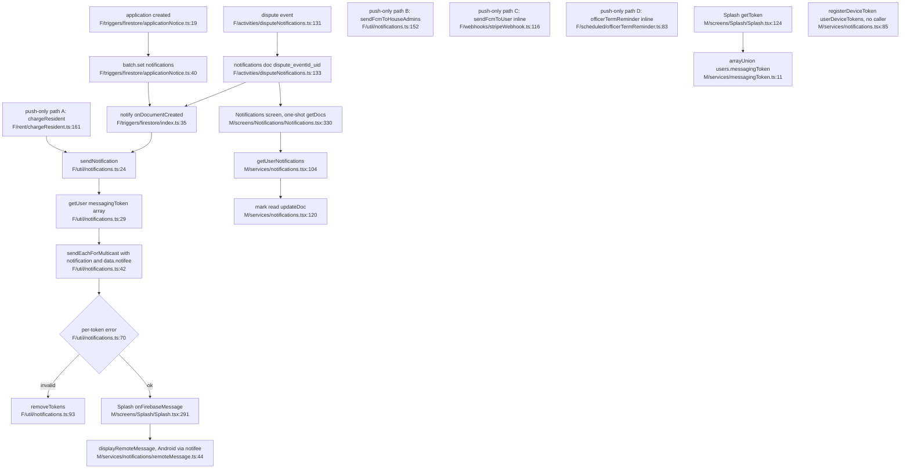
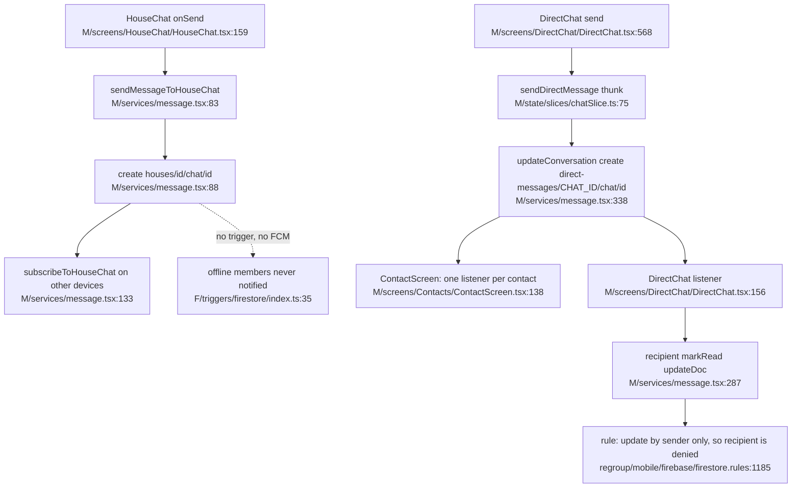
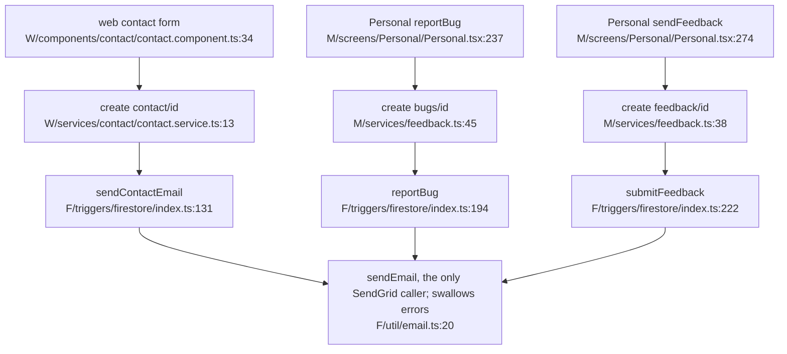

# L9 messaging-and-notifications

Prefixes: `M/` = `regroup/mobile/src/`, `F/` = `regroup/functions/src/`, `W/` = `regroup/web/src/app/`. Rules file: `regroup/mobile/firebase/firestore.rules`.

## Path (i): server event, inbox doc, FCM, device, inbox screen

## Path (ii): house chat and DMs (client-only Firestore, no server notification)

## Path (iii): support intake to email

## FCM send paths (lead a, confirmed)

| Send site                                                                                   | Recipient token source                                                                                                                                                     | Payload                                               | Inbox doc                                   | Stale-token cleanup               |
| ------------------------------------------------------------------------------------------- | -------------------------------------------------------------------------------------------------------------------------------------------------------------------------- | ----------------------------------------------------- | ------------------------------------------- | --------------------------------- |
| `sendNotification` (`F/util/notifications.ts:42`), via `notify` and `chargeResident.ts:161` | `users/{uid}.messagingToken[]`                                                                                                                                             | `notification` + Android `channelId` + `data.notifee` | via `notify`: yes; via `chargeResident`: no | yes (`:65-107`)                   |
| `sendFcmToHouseAdmins` (`F/util/notifications.ts:152-235`)                                  | house `adminIds`, `adminId`, `superAdminIds`, `superAdminId`, `ownerId`, then `users.messagingToken`. `adminIds` hold admin-record ids, not uids, so this may miss admins. | `notification` + `channelId`; no `notifee`            | no                                          | none                              |
| `sendFcmToUser` (`F/webhooks/stripeWebhook.ts:116-146`)                                     | `users/{uid}.messagingToken`                                                                                                                                               | `notification` only                                   | no                                          | none; logs the raw token (`:135`) |
| `officerTermReminder` (`F/scheduled/officerTermReminder.ts:83`)                             | `users/{uid}.messagingToken`                                                                                                                                               | `notification` + `data`; no `channelId`, no `notifee` | no                                          | yes, a second copy (`:95-123`)    |

Only `sendNotification` sets `data.notifee`. Android foreground display depends on it (`M/services/notifications/remoteMessage.ts:45-48`), so pushes from the other three paths are probably silent while the app is open. This is inferred from the code, not tested on a device.

Email has a single sender, `F/util/email.ts:20`. Three call sites hard-code the admin address instead of using `regroupEmail`: `F/callable/subscriptions.ts:328,385`, and the constant is defined at `email.ts:6`. `sendSubscriptionUpdateEmail` (`F/triggers/firestore/index.ts:161`) fires on every `users/{id}` update.

## Findings beyond duplication (to verify)

- **DM read receipts are probably denied.** The recipient calls `markRead` (`M/services/message.tsx:287-292`), but the rule allows updates by the sender only (`firestore.rules:1185`). No rules test was run.
- **Confidential complaints are readable by every member.** `firestore.rules:728-735` describes complaints as confidential. But complaints are stored in the `houses/{id}.complaints` map, and every member can read the house doc. Writes to that map replace the whole map from the client's cached copy (`M/screens/Personal/Personal.tsx:168-171,200-206`), so two concurrent filings lose one of them.
- **Notification preferences do nothing.** `notificationPrefs` has no reader on the server (`M/screens/Notifications/Notifications.tsx:303-320`). Inbox taps do not navigate anywhere, and `notify` sends no `data`.
- **PII in push payloads:**
  - The admin push includes the resident's full name (`F/webhooks/stripeWebhook.ts:658-662`).
  - The application inbox doc and push include `applicantName` (`F/triggers/firestore/applicationNotice.ts:44`).

## Within-lane duplication found

- **FCM sending:** four send implementations, two copies of the stale-token cleanup, and two admin-resolution routines. `sendFcmToHouseAdmins` uses `adminIds` (`F/util/notifications.ts:168-177`), while `applicationNotice.ts:33-35` uses `staffUids` plus `superAdminId`.
- **Device-token stores:**
  - Live: `users.messagingToken`. Every send reads it.
  - Dead: `userDeviceTokens` (`M/services/notifications.tsx:85-98`). Only account deletion touches it.
- **Chat and DM plumbing in `M/services/message.tsx`:**
  - `onChatSnapshot` (`:115`) duplicates `onHouseChatSnapshot` (`:170`).
  - `sendMessageToHouseChat` (`:83`) duplicates `updateConversation` (`:338`).
  - `loadChat` (`:187`) duplicates `loadDirectChat` (`:217`).
  - `subscribeToHouseChat` (`:133`) duplicates `subscribeToDirectChat` (`:261`).
  - Message objects are built inconsistently: plain objects at `HouseChat.tsx:104-125`, `new Message` at `chatSlice.ts:95`.
- **DM listeners:** ContactScreen opens one listener per contact (N+M in total), and DirectChat opens another on the same conversation.
- **Issues and complaints are stored in two places.**
  - The house-doc maps are live.
  - The root collections `issues` and `complaints` are legacy. `createIssue`, `createComplaint` and `removeComplaint` have no callers.
- **Dead notification code:**
  - `notificationsSlice` (dead state: `unreadCount`, `fcmToken`)
  - `addNotification` / `createInviteNotification` (reached only from a test)
  - the `notifications` argument of `updateDispute` (its only caller passes `[]`)
  - `createNotification` on the client (no caller)
- `NotificationContext` is a toast provider. It only shares the name.

## External dependencies

- L4: dispute notifications.
- L6 and L7: `stripeWebhook.ts` sends, `overdueRentNotification`, `chargeResident`.
- L8: `officerTermReminder`.
- L2: `staffUids` and invite emails.
- L1: house-doc maps.
- Account deletion: `userDeviceTokens` and `notifications`.

## Gaps

- `rentReminder.ts` and `channels.ts` were not read.
- I did not check whether any rule covers `userDeviceTokens`.
- I did not confirm that `SENDGRID_API_KEY` is bound on the webhook, subscriptions and invitations functions.
