# 03 Unified proposal: Regroup + recovery-api

This document says what the code SHOULD look like. It covers only the concerns `02-duplication-report.md` marked ACCIDENTAL (or the accidental half of MIXED). The specializations listed at the end of 02 stay as they are.

Prefixes: F = `regroup/functions/src`, M = `regroup/mobile/src`, P = `regroup/portal/src/app`, W = `regroup/web/src/app`, R = `regroup/mobile/firebase/firestore.rules`.

Two rules shape every proposal below:

1. **There is no new shared package.** Regroup's three runtimes (functions, mobile and the Angular web app) share no code today, and the root `CLAUDE.md` says `shared/` does not exist. Each concept gets **one implementation per runtime**, and the portal imports the phone's through the `@mobile/` alias it already uses. Where the server and a client must agree, both test suites carry the same truth table. Building a shared package would be the abstraction layer the anti-pattern list rejects.
2. **No live users** (`regroup/CLAUDE.md`, 2026-11-10). So there are no feature flags, no dual-write periods and no compatibility shims for older app builds. When a path is replaced, it is deleted in the same change.

Defects D1, D2, D5 and D6 from 02 are not duplication. They get their own handoff in 04 (H0) and should land first.

---

## U1. House staff directory and one grant path

**Fixes:** C2, D4, D7, and the L2 grant-sequence copies.

**Component:** `F/util/houseRoleStore.ts`. Its existing `staffUids(houseId)` (`:98-110`) becomes the only answer to "who are this house's staff", together with `readRoleTier` / `isPrimaryOwner`. All of them read `house-roles` records plus live claims. House-doc `adminIds` and `superAdminIds` hold admin-record ids, so they are **never compared to a uid again**.

**Single grant entry:** one `grantHouseRole(uid, houseId, tier, via)` in `F/util/houseRoles.ts`. It does the claim write and the record write in one fixed order, whichever order the comment at `houseRoles.ts:42` justifies for retries. Every grant goes through it.

What each old call site becomes:

| Old                                                                                                                                         | Becomes                                                                                                                                              |
| ------------------------------------------------------------------------------------------------------------------------------------------- | ---------------------------------------------------------------------------------------------------------------------------------------------------- |
| `F/util/houseAuth.ts:15-22` `isHouseAdmin`, `:46-54` `isHouseMoneyStaff`, `:72-89` `checkIsMember` (house-doc id fields)                    | Tier from `readRoleTier` (owner or manager means money staff); membership from live claims. Delete the house-doc id branches.                        |
| `F/callable/payments.ts:634,808` `assertHouseAdmin`                                                                                         | The same money-staff check (rank ≥ manager).                                                                                                         |
| `F/util/notifications.ts:168-177` recipient union                                                                                           | `staffUids(houseId)` (see U2).                                                                                                                       |
| `F/activities/disputeNotifications.ts:104-108`                                                                                              | `staffUids(houseId)`.                                                                                                                                |
| `M/hooks/useTreasuryRole.ts:35-37`                                                                                                          | `isAdmin(token, houseId)` (`M/util/roles.ts:35`) for staff, plus `useMayEditRentMoney` (`M/state/queries/houseTierQueries.ts:16`) for owner/manager. |
| `P/access.ts:13` `isStaffRole`                                                                                                              | Import `isAdmin` from `@mobile/util/roles`.                                                                                                          |
| `F/callable/auth.ts:97-106,179-202,325-329` (record → claims → record, three copies); `F/callable/invitations.ts:285-290` (claims → record) | `grantHouseRole(...)` everywhere.                                                                                                                    |
| `F/callable/auth.ts:248-257,389-395` (`deleteClaim` + `setCustomUserClaims`)                                                                | `revokeHouseRoles` (`F/util/claims.ts:128`), the one revoke primitive.                                                                               |

**Capability lost:** none for any house created by `createHouses`. A legacy house whose `adminIds` happen to hold uids would lose its non-owner staff. None exist.

**Out of scope:** removing the `adminIds` / `superAdminIds` fields themselves. First grep the rules for any reader of them, then delete in a follow-up.

## U2. One notification path

**Fixes:** C1, the `userDeviceTokens` store, PII in push bodies, and the token logging.

**Component:** `notifyUsers({ uids, kind, refId, title, body, data })` in `F/util/notifications.ts`. For each recipient it creates one inbox doc, `notifications/{kind}_{refId}_{uid}`, using `create` with ALREADY_EXISTS treated as success. That is the idempotency scheme `F/activities/disputeNotifications.ts:131-148` already uses, and it absorbs webhook retries when `refId` is the Stripe event id.

The existing `notify` trigger (`F/triggers/firestore/index.ts:35`) → `sendNotification` (`F/util/notifications.ts:24-107`) becomes the **only FCM sender**. It already sets the Android channel and the `notifee` payload, and already prunes stale tokens.

| Old                                                                                                                                                    | Becomes                                                                                                                                                           |
| ------------------------------------------------------------------------------------------------------------------------------------------------------ | ----------------------------------------------------------------------------------------------------------------------------------------------------------------- |
| `sendFcmToHouseAdmins` (`F/util/notifications.ts:152-235`), 6 callers in `F/webhooks/stripeWebhook.ts` and `F/scheduled/overdueRentNotification.ts:61` | `notifyUsers({ uids: await staffUids(houseId), ... })`                                                                                                            |
| `sendFcmToUser` (`F/webhooks/stripeWebhook.ts:116-146`), 8 call sites                                                                                  | `notifyUsers({ uids: [uid], refId: event.id, ... })`                                                                                                              |
| `F/scheduled/officerTermReminder.ts:83-123` (inline send and pruning copy)                                                                             | `notifyUsers`                                                                                                                                                     |
| `F/rent/chargeResident.ts:161` (direct `sendNotification`, so no inbox doc)                                                                            | `notifyUsers`                                                                                                                                                     |
| `F/activities/disputeNotifications.ts:131-145`, `F/triggers/firestore/applicationNotice.ts:40` (hand-written inbox docs)                               | `notifyUsers`                                                                                                                                                     |
| `M/services/notifications.tsx:85-98` `registerDeviceToken` (`userDeviceTokens`)                                                                        | Deleted. `users.messagingToken` (`M/services/messagingToken.ts:11`) is the only token store.                                                                      |
| `M/services/notifications/rentReminder.ts` (a client-local reminder that assumes rent is due Monday)                                                   | Deleted. The server already knows `rentDueDate` in the house timezone, so `overdueRentNotification` also sends the resident their reminder through `notifyUsers`. |
| Bodies naming residents (`F/webhooks/stripeWebhook.ts:658-662`, `F/triggers/firestore/applicationNotice.ts:44`)                                        | Generic text ("A resident paid rent"). The name appears only in the app, behind rules.                                                                            |

**Capability lost:** the offline local rent reminder. That's acceptable, because it ignored the real due date. **Gained:** every push now has an inbox entry, and all paths display while the Android app is in the foreground.

## U3. One predicate per concept, one copy per runtime

**Fixes:** C5, C6, C3 (the accidental half) and C15.

Each concept gets one canonical definition per runtime. The portal deletes its copies and imports the phone's. The real root cause of the copies is that the portal's vitest cannot resolve `@mobile/` (`P/houses/summary.ts:71-72`), so that resolution gets fixed instead of copying around it.

| Concept              | Server (authority)                                                                                                        | Phone (canonical)                                                                                                                                                                            | Rewritten call sites                                                                                                                                                                                                                                                                                                 |
| -------------------- | ------------------------------------------------------------------------------------------------------------------------- | -------------------------------------------------------------------------------------------------------------------------------------------------------------------------------------------- | -------------------------------------------------------------------------------------------------------------------------------------------------------------------------------------------------------------------------------------------------------------------------------------------------------------------- |
| **Current resident** | `isActiveGuestDoc` (`F/util/guestMembership.ts:100-102`): an allow-list (status absent or `active`, and no `moveOutDate`) | `isCurrentResident` (`M/util/paymentDisplay.ts:52`), **redefined to the server's allow-list**                                                                                                | Server: `F/callable/analytics.ts:264-266`, `F/scheduled/overdueRentNotification.ts:29-36`. Phone: `M/screens/GuestList/GuestList.tsx:211-217`, `M/hooks/useDefaultGuestSelection.ts:12`, `M/util/house.tsx:165`. Portal: `P/houses/summary.ts:71-73`, `P/houses/useHouseSummary.ts:80`, `P/residents/rows.ts:21-22`. |
| **Owed now**         | `rentRoiMetrics` outstanding (`F/callable/analytics.ts:268-281`) adopts the phone rule                                    | `owedNowCents` (`M/util/paymentDisplay.ts:56-57`): rent plus chore fees, floored at 0 per resident                                                                                           | `M/state/queries/paymentQueries.ts:180-181`, deleted along with BalanceDashboard (U12); `P/houses/summary.ts:77-98`.                                                                                                                                                                                                 |
| **House access**     | `evaluateEntitlement` (`F/util/entitlement.ts:40-76`), unchanged                                                          | `evaluateHouseAccess` (`M/hooks/useSubscriptionGate.ts:90-111`), exported, with **grace limited to `past_due`** to match the server. Absent status stays `pending` (a deliberate UX choice). | `P/houses/summary.ts:50-64`.                                                                                                                                                                                                                                                                                         |
| **House health**     | none                                                                                                                      | `getHousePercentage` (`M/util/house.tsx:150-162`) returns `null` when nothing is scored, which is the portal's more honest choice                                                            | `P/houses/summary.ts:111-118`, `P/houses/useHouseSummary.ts:88-91`.                                                                                                                                                                                                                                                  |
| **Staff role**       | U1                                                                                                                        | `isAdmin` (`M/util/roles.ts:35`)                                                                                                                                                             | `P/access.ts:13`.                                                                                                                                                                                                                                                                                                    |

**Enforcement:** the F and M test suites each get the same truth-table test (status × `moveOutDate` × grace → expected result), with a comment in each pointing to the other.

**Capability lost:** none. Residents with status `inactive`, `expelled` or `archived`, or with a `moveOutDate`, now drop out of phone and portal rosters. The server already excludes them.

## U4. One week and date module per runtime

**Fixes:** C4.

- **Server:** `F/activities/weekSummaryMath.ts` holds `weekStartFor`, `resolveTimeZone`, `localDateString` and `summaryDocId`. Rent already depends on it. It becomes the only date module.
- **Phone:** `getWeekStart(date, timeZone)` in `M/hooks/activity/useCurrentWeek.ts:35-40` is the only phone week function. It remains the documented mirror of the server rule (legitimate). Its siblings `isInCurrentWeek`, `getPreviousWeek` and `getNextWeek` (`:117-151`) take a **required** `timeZone`.

| Old                                                                                                                                                                                                                                                                                                  | Becomes                                                                                                                      |
| ---------------------------------------------------------------------------------------------------------------------------------------------------------------------------------------------------------------------------------------------------------------------------------------------------- | ---------------------------------------------------------------------------------------------------------------------------- |
| `F/util/week.ts:33` `getCurrentWeekStart` (UTC), used at `F/util/guest.ts:64,85,93,129`; `:12` `buildWeekId`                                                                                                                                                                                         | `weekStartFor(now, house.timezone)` and `summaryDocId`. Delete `F/util/week.ts`.                                             |
| `F/triggers/firestore/guestWrite.ts:216` `isoWeekStartUtc`                                                                                                                                                                                                                                           | `weekStartFor`                                                                                                               |
| `F/scheduled/overdueRentNotification.ts:22-24`, `F/callable/analytics.ts:274` (UTC "today")                                                                                                                                                                                                          | `localDateString(now, house.timezone)`                                                                                       |
| `M/services/oxford/ees.ts:80-90`, `M/services/treasury.ts:131-135,153-157`, `M/screens/Treasury/FinancialRecordForm.tsx:55-61`, `M/screens/Oxford/EESTracker.tsx:45`                                                                                                                                 | `getWeekStart(now, house.timezone)`                                                                                          |
| `M/util/display.tsx:166-207` (Sunday, device-local), used by `M/util/guest.tsx:178-179` and `display.tsx:253-254`; `M/util/dateWithTimezone.ts:38-100` week functions                                                                                                                                | Callers move to `getWeekStart`. Delete the week helpers.                                                                     |
| `M/services/choreRotation.ts:14`, `M/hooks/useAutoAdvanceRotation.ts:7` (identical Sunday functions)                                                                                                                                                                                                 | `getWeekStart(now, house.timezone)`. Rotation flips on the house's week start.                                               |
| Two `useWeekSummary` hooks: React Query at `M/state/queries/activityQueries.ts:199` (used by `GuestHome.tsx:245` and `GuestList.tsx:126`), and onSnapshot at `M/hooks/activity/useWeekSummary.ts:40`; plus `getWeekSummaryOnce` (`:118`) duplicating `getWeekSummary` (`M/services/activity.ts:306`) | Keep the onSnapshot hook, because the server writes those docs. Delete the React Query hook and one of the one-shot getters. |

**Capability lost:** none. Stored treasury and EES `period` keys change form, which is fine with no live data. Chore rotation moves from Sunday to the house's Monday week start. That is a visible behaviour change and should be called out in the PR.

## U5. Server-owned guest lifecycle side effects

**Fixes:** C13, the accidental half of C10, and D13.

**Component:** `onGuestWrite` (`F/triggers/firestore/guestWrite.ts:61`). It already runs on every guest write, already revokes claims, and already re-splits EES. It becomes the **only writer of derived guest state**.

- **New server-only field `houses/{id}.residentCount`**, recomputed in `onGuestWrite` with the U3 predicate. A recount converges under concurrent writes. It replaces both counters:
  - the client-maintained `house.currentCapacity`, written at `M/services/guest.tsx:257-259` (+1, whole-house write) and `:291-298` (−1). Discharge and CSV import never update it.
  - `subscriptionMetadata.houses[h].numberOfGuests`, written by `F/util/residentCapacity.ts:110-127` and the dead `F/callable/subscriptions.ts:577-586`. It is never decremented.
- **Cap check:** `assertResidentCapacityAvailable` (`F/util/residentCapacity.ts:57-100`) reads `residentCount` plus pending invites. Its caps come from the tier config (U6). Delete `withinResidentCap` (`F/util/tierCaps.ts:7-10`).
- **Readers move to `residentCount`:** `M/screens/IntroHouseSummary/IntroHouseSummary.tsx:225,521` and `M/screens/HouseOverview/HouseInfo/HouseInfo.tsx:223`.
- **Rules:** add `residentCount` to the server-owned list at R:582-584.
- **Claim revoke happens only in the trigger.** Delete the client call to `removeGuestPrivileges` in `dischargeGuest` (`M/services/guest.tsx:383-386`). The trigger already revokes (`guestWrite.ts:126-129,198`), so there is no more misleading "contact support" alert on discharge (`M/screens/Profile/DischargeGuestModal.tsx:43-46`).
- **One client create helper:** `createGuest` (`M/services/guest.tsx:255`, without the house update). CSV import (`M/services/guestImport.ts:94-126`) calls it, so intake and import share email lowercasing and the email regex (`M/util/form.tsx:70`). Delete the import's own regex at `guestImport.ts:16`.

**Capability lost:** revocation becomes asynchronous, delayed by trigger latency. That's acceptable: the old client call also did not force-refresh the target user's token, so the old claims stayed valid until refresh anyway.

## U6. Operator billing: one writer per field, and deletion of everything unreachable

**Fixes:** the L7 duplication, the accidental parts of C3 and C14, D12, and the stale billing docs.

- **Writers of `users.subscriptionMetadata`:**
  - status, period, tier and interval: only the webhook (`F/webhooks/subscriptionState.ts:25-40`, `F/webhooks/syncOperatorTier.ts:17-40`), in transactions with dotted paths
  - the checkout seed: `writeOperatorSubscription` (`F/util/operatorSubscriptionWrite.ts:14`)
  - the houses map: `createHousesTx.ts:145` and `houseTombstone.ts:33`

  Every whole-map `updateUser` write goes away with the callables that make it (next item).

- **Delete the callables no client reaches:** `cancelUserSubscription` (`F/callable/subscriptions.ts:493`), `reactivateOperatorSubscription` (`:397`), `updateSubscriptionGuests` (`:533`), `updateSubscriptionHouses` (`:607`), `applyBundleDiscount` (`:690`), `sendConfirmationEmail` (`:767`). Also delete their web wrappers (`W/services/functions/cloud-function.service.ts:14,72,78`) and phone wrappers (`M/services/subscription.ts:13,17,22`). Move `createHouses` (`:44`) to a houses service.
  - Cancel and resume go through the Stripe billing portal (`createBillingPortalSession`, `:734`, live).
  - Resubscribing after a full cancel goes through the single checkout entry, `createOperatorSubscription` (`:203`), which uses `createTierSubscription` (`F/api/stripe.ts:151-173`). This removes the second creation path (`api/stripe.ts:212-235`) that dropped the annual interval (D12).
  - The plan must first confirm that checkout accepts an operator whose subscription is `canceled`. If it doesn't, fold the replacement logic from `:427-485` into checkout. Do not keep the callable.
- **Delete legacy two-item billing:**
  - `F/api/stripe.ts:38,50,115,176,200-259 (legacy branch),287,298,330,337,353-375,395,423,487`
  - the unreachable block `F/callable/subscriptions.ts:336-390`, plus unused imports `:24-28`
  - the old status model in `F/api/firestore.ts:146-201`
- **Caps come from config:** `tierCaps(houseType, tier)`, read from `F/config.ts:130-228` by stored tier. Delete the persisted `maxResidents` / `maxProperties` snapshot at `subscriptions.ts:293-294`, `syncOperatorTier.ts:34-39` and `api/stripe.ts:227-228`, and move its readers (`residentCapacity.ts:70`, `subscriptionHouses.ts:56`) to the config lookup. **Capability lost:** per-operator grandfathered caps. No operators exist.
- **One status type:** `HouseSubscriptionStatus` (`F/util/entitlement.ts:164-169`). Delete the copy at `F/webhooks/stripeWebhook.ts:251-256`.
- **Web reads `salesOpen` and `trialDays` from the catalog** it already fetches (`F/callable/getTierCatalog.ts:148-150`). Closed sales are shown before an account exists, instead of after the create-then-delete loop at `W/services/auth/auth-service.service.ts:246,266`. Delete `TRIAL_DAYS` (`W/components/pricing/order-summary/order-summary.component.ts:4`).
- **One account URL:** `M/screens/SubscriptionHandler/SubscriptionHandler.tsx:22-23` uses the same env-derived URL as `M/screens/Subscription/SubscriptionRequiredScreen.tsx:22-25`.
- **Fix the stale docs** listed in 02 Part C.

## U7. Money plumbing: one Stripe client, one Connect status writer, one balance rule, one pay screen

**Fixes:** C7, C6 (ledger half), D9, D11 and the L6 duplication.

- **Stripe client:** a memoized `getStripe()` in `F/util/stripe.ts`. Delete the Proxy (`F/api/stripe.ts:20-31`), the two memoizers (`F/webhooks/stripeWebhook.ts:18`, `F/http/stripeConnect.ts:31`) and the inline client (`F/scheduled/scheduledRentCollection.ts:116`, or the whole job; see U12).
- **Connect status:** one `syncHouseConnectStatus(houseRef, account)` in `F/util/connectAccountStatus.ts` (the file already exists). It writes the full field set, including `stripeLastSyncAt` and clearing `stripeError`, and owns the "closed means disconnected" branch. It is called from `F/callable/payments.ts:959-966,996-1003` and `F/webhooks/stripeWebhook.ts:1409-1431`.
- **Applying money to a balance:** one `applyPaymentToBalance(tx, { guestRef, paymentRef, cents })` in `F/rent/`. It applies the existing `rentApplied` marker and the refund netting (`F/webhooks/refundRestore.ts:58-67`). It also holds the **single allocation rule** for splitting a payment between `rentOwed` and `choreFees`. **The owner picks the order**; the default is rent first, the remainder to chore fees, and any overpayment as a credit on rent. It is used by:
  - the webhook success path (`F/webhooks/stripeWebhook.ts:615-641`)
  - refund restore (`F/webhooks/refundRestore.ts:20-41`)
  - staff manual payments, which move from the client batch (`M/services/payments.ts:434-479`, no idempotency marker) to a server `recordManualPayment` callable
  - The manager's direct balance edit (`M/services/guest.tsx:74,196`) stays as a deliberate _adjustment_, which is a different intent from recording a payment.
- **One pay screen:** `RentPaymentScreen` (`M/screens/RentPayment/RentPaymentScreen.tsx`) gains an optional amount. Delete `M/screens/Payments/ResidentPayment.tsx` and its Stripe shim, and point `GuestHome.tsx:558` at `RentPaymentScreen`. Delete the optimistic `recordRentPayment` (`M/services/payments.ts:226-261`), which the rules deny for residents (D11). The webhook is the record.
- **One destination gate:** `createRentDestinationLookup` (`F/scheduled/rentDestination.ts:32-54`), also used by `F/callable/payments.ts:149`.

**Capability lost:** none. Staff manual payments become idempotent.

## U8. One compliance rule and one export

**Fixes:** C12.

- **One weekly rule:** `checkPhaseCompliance` (`M/util/compliance.ts:51-80`). `M/services/weeklyReportHtml.ts:19-26,62-77` and `M/services/reportingService.ts:139-140` call it. Delete the hard-coded `>= 3` / `> 0` rule.
- **One court export:** the server `complianceExport` (`F/callable/compliance.ts:373`), which is tier-gated, owner-checked, and includes drug tests and dispute history. The two existing export buttons call it:
  - `M/screens/Profile/GuestHome.tsx:381`
  - `P/residents/ComplianceExport.tsx:36`

  Delete the client PDF builder (`M/services/reportExport.ts:26-50` and `M/services/weeklyReportHtml.ts`), together with the dead `exportEESHistoryCSV` (`reportExport.ts:92-119`). Fix the export's drug-test read to filter by `houseId` as well as `guestId` (`F/api/firestore.ts:320-325`).

- **Capability lost:** the client's weekly PASS/FAIL PDF. It never worked on iOS (`reportExport.ts:19-21`) and bypassed the tier gate. If the owner wants that table, it becomes a section of the server export, computed from `week-summaries`. It does **not** come back as a second export.

## U9. Oxford money records: one service per collection, cents everywhere

**Fixes:** the L8 duplication and D8.

- **`financial-records`:** one service and one query cache, `M/services/treasury.ts` with `M/state/queries/treasuryQueries.ts`.
  - Delete `M/services/oxford/index.ts:391-430` and `M/state/queries/oxfordQueries.ts:64-65,482-510`.
  - `M/state/queries/charterComplianceQueries.ts:6,31` switches to the treasury hook, so a treasury write refreshes charter compliance.
- **`ees-records`:** one service and one shape, `M/services/oxford/ees.ts` with the `EESRecord` type.
  - Delete the `EESTransaction` entity, `M/services/oxford/index.ts:355-387`, and the third `EESRecord` (`M/services/reportExport.ts:92`).
  - Amounts are stored in **cents**, matching rent. `getEESIncomeForWeek` (`M/services/treasury.ts:171-188`) sums **paid** records only.
  - `createEESRecords` writes `totalExpenses`, so the server re-split (`F/triggers/firestore/guestWrite.ts:243-289`) actually runs. The two splits must agree on one divisor: the U3 current-resident predicate.
  - Fix the setter for the `totalExpenses` input (`M/screens/Oxford/EESTracker.tsx:47`).
- **Officers:** `createOfficer` (`M/services/oxford/index.ts:74-110`) is the only officer writer. The onboarding batch (`M/state/mutations/oxfordOnboardingMutations.ts:41-48`) calls the same builder.

## U10. Complaints and issues: one store each

**Fixes:** D3 and the issues/complaints duplication in L9.

- **Complaints** live only in the root `complaints/{id}` collection. Its rules already give the confidential access model, admins plus the plaintiff (R:728-735). Writes go through the existing `createComplaint` / `removeComplaint` (`M/services/complaints.ts:15,19`). Delete the house-map writes at `M/screens/Personal/Personal.tsx:168-171` and `M/screens/Complaints/Complaints.tsx:79-139`.
- **Issues** live only in the root `issues/{id}`, written with `createIssue` (`M/services/issues.ts:17`), one document per issue, so there are no lost whole-map updates. Delete the map writes at `M/screens/Personal/Personal.tsx:200-206` and `M/services/issues.ts:34,82`.
- **Rules:** remove the `issues` and `complaints` keys from the house update whitelist (R:595-599).
- **Capability lost:** none. The open-issue count in HouseSummary becomes a query.

## U11. One conversation module for chat

**Fixes:** the L9 chat duplication and D10.

- `M/services/message.tsx` gets one set of operations parameterized by conversation path (`houses/{id}/chat` or `direct-messages/{cid}/chat`): `sendMessage`, `subscribe`, `loadPage` and `mapSnapshot`. This replaces the pairs at `:83/:338`, `:115/:170/:242`, `:133/:261` and `:187/:217`. Direct messages keep their `ownMessagesFilter` (`:159-165`), which the rules require and which is legitimate.
- **One message builder,** `new Message(...)` (`M/entities/Message.tsx:59,75`), with one `sortKey` convention matching the `orderBy('sortKey','desc')` queries. This replaces the builders at `M/screens/HouseChat/HouseChat.tsx:104-125`, `M/screens/DirectChat/DirectChat.tsx:209-227` and `M/screens/DirectChat/hooks/useChatLogic.ts:108-124`.
- **Rules (D10):** the recipient may update only `read` on a direct message (R:1182-1186).

## U12. Delete dead parallel models

**Fixes:** C14 and C9. Items owned by U2, U6, U7 and U8 are not repeated here.

Each item is a deletion with no replacement, because the live replacement already exists:

- **Legacy disputes:**
  - `updateDisputes` (`F/scheduled/index.ts:26`, `F/scheduled/disputeUpdates.ts`, `F/util/disputes.ts`)
  - `F/api/firestore.ts:258-288`
  - the client `challengeDispute` path (`M/hooks/useBaseActivityScreen.ts:154,237-267`, `M/services/dispute.tsx`, `M/state/queries/disputeQueries.ts`)
  - the `houses.disputes` mirror writes (`F/activities/houseDisputeMirror.ts:231-256`) and their readers (`M/util/guest.tsx:483`, `M/util/house.tsx:237`)

  The mirror was kept for older app builds; with no shipped users that reason is gone. **Confirm no store build is live before deleting.**

- **`guest-weeks`:** `F/api/firestore.ts:16` and its account-deletion sweep (`F/accountDeletion/personalData.ts:92-93`).
- **Redux state that duplicates React Query:** `authSlice` (`M/state/slices/authSlice.ts`, `M/state/store.ts:36,56`), `notificationsSlice`, `guestsSlice.guests`/`cacheGuests` (`M/state/slices/guestsSlice.ts:6-65`), and the `meetingsSlice.checkIntoMeeting` thunk (`:66-103`).
- **Orphan screens:** `M/screens/{HouseConfig,HouseChoreOverview,SubscriptionUpdateModal,CreateGuest,GuestUpdate}` and `M/screens/HouseSettings/ChoreRotationSetupScreen.tsx`. Delete the dead create paths along with them: `M/services/house.tsx:58`, `setupSlice.ts:87-117`, `houseQueries.ts:156-160`, `updateHouseBatch` (`house.tsx:325-405`).
- **Unreachable routes:** `PaymentWebView` and `BalanceDashboard` (with `useGuestBalances`).
- **Dead meeting sources:** `F/api/api.ts:26-103` and `F/api/firestore.ts:246-252,384-398`, plus `F/util/geohash.ts`, `getNearbyHouses` (`F/api/firestore.ts:117`) and `F/util/location.ts:89-110`. The phone's `getGeohashRange` stays. Also the `M/entities/{AAMeeting,NAMeeting}` types.
- **Callables with no caller:**
  - `givePotentialSuperAdminPrivilege` (`F/callable/auth.ts:420`)
  - `verifyUserEmail` (`:404`), which sets `emailVerified` without checking the inbox
  - `getPaymentMethod` (`F/callable/payments.ts:480`) and `updatePaymentInfo` (`:508`)
  - `setOxfordEnabled` (`F/callable/oxford.ts:45`)
  - The legacy token-less invite branch: `M/screens/SignUp/SignUpForm.tsx:121-125,184-187`, `M/services/native-deep-links.ts:154-172`, and `addGuestAuthorization`/`addAdminAuthorization` (`F/callable/auth.ts:57,119`)
- **`EnhancedAuthService.ts`**, and its stale mention at `.claude/rules/architecture.md:78`.
- **Scheduled autopay:** `F/scheduled/scheduledRentCollection.ts`, `rentAttempts.ts`, and the `autoPayEnabled` index. It charges no one (`:20-21`). **Owner decision:** delete it now (recommended) or wire it up as a feature. Leaving it deployed half-alive is the anti-pattern.
- **One house selection:** `housesSlice.selectedHouseId`. Delete `housesSlice.selectedHouse`/`selectHouse` (`M/state/slices/housesSlice.ts:7,28`). Also delete the trigger's redundant re-stamp of `subscriptionStatus` (`F/triggers/firestore/index.ts:90-122`), because `createHousesTx.ts:166` already writes it and the rules forbid any other create path.
- **Verify, then fix in place:** the meeting-type casing, where functions use `'CUSTOM'` (`F/util/directoryMapping.ts:30`) and the phone uses `'Custom'` (`M/entities/Meeting.tsx:22`). Make the phone's enum the one the callable returns.

---

## Rejected in this proposal (anti-pattern guards)

- A `shared/` npm package for entities or predicates. It would be a new abstraction layer. U3 uses one copy per runtime plus mirrored truth-table tests.
- A notification "provider" or registry. U2 is one function plus one trigger.
- Keeping the dead callables "in case the web needs them". U6 and U12 delete them.
- Feature-flagging the legacy dispute and billing paths. There are no users, so they are deleted.
- Keeping both export paths. U8 keeps one.

## Combined unified flowchart

```mermaid
flowchart TD
  subgraph Clients
    PH["Phone screens<br/>regroup/mobile/src/navigation/navigators.tsx:159"]
    PO["Portal, imports phone via @mobile<br/>regroup/portal/src/app/routes.tsx:1"]
    WB["Web billing pages<br/>regroup/web/src/app/app-routing.module.ts:32"]
  end

  subgraph Phone_canonical["Phone canonical modules (portal imports these)"]
    PRED["isCurrentResident, owedNowCents<br/>regroup/mobile/src/util/paymentDisplay.ts:52"]
    GATE["evaluateHouseAccess, grace only for past_due<br/>regroup/mobile/src/hooks/useSubscriptionGate.ts:90"]
    WEEK["getWeekStart with required timezone<br/>regroup/mobile/src/hooks/activity/useCurrentWeek.ts:35"]
    ROLES["isAdmin<br/>regroup/mobile/src/util/roles.ts:35"]
    COMP["checkPhaseCompliance<br/>regroup/mobile/src/util/compliance.ts:51"]
    CHAT["conversation module, one builder<br/>regroup/mobile/src/services/message.tsx:83"]
    TREAS["treasury + ees services, cents<br/>regroup/mobile/src/services/treasury.ts:51"]
    GCREATE["createGuest, single client create<br/>regroup/mobile/src/services/guest.tsx:255"]
  end

  PH --> PRED & GATE & WEEK & ROLES & CHAT & TREAS & GCREATE
  PO --> PRED & GATE & ROLES
  PH --> COMP

  subgraph Server["Functions"]
    STAFF["staffUids / readRoleTier<br/>regroup/functions/src/util/houseRoleStore.ts:98"]
    GRANT["grantHouseRole<br/>regroup/functions/src/util/houseRoles.ts:42"]
    NOTIFY["notifyUsers, idempotent inbox docs<br/>regroup/functions/src/util/notifications.ts:24"]
    NTRIG["notify trigger, only FCM sender<br/>regroup/functions/src/triggers/firestore/index.ts:35"]
    GW["onGuestWrite: residentCount, revoke, EES<br/>regroup/functions/src/triggers/firestore/guestWrite.ts:61"]
    ACTIVE["isActiveGuestDoc<br/>regroup/functions/src/util/guestMembership.ts:100"]
    WMATH["weekStartFor, localDateString<br/>regroup/functions/src/activities/weekSummaryMath.ts:113"]
    ENT["evaluateEntitlement<br/>regroup/functions/src/util/entitlement.ts:40"]
    CAPS["tier caps from config<br/>regroup/functions/src/config.ts:130"]
    CHECKOUT["createOperatorSubscription, single checkout<br/>regroup/functions/src/callable/subscriptions.ts:203"]
    WH["stripeEvents webhook<br/>regroup/functions/src/webhooks/stripeWebhook.ts:1628"]
    SUBW["subscription state writers, dotted tx<br/>regroup/functions/src/webhooks/subscriptionState.ts:25"]
    APPLY["applyPaymentToBalance, one allocation rule<br/>regroup/functions/src/rent/ (new)"]
    MANUAL["recordManualPayment callable<br/>regroup/functions/src/callable/payments.ts (new)"]
    CONNECT["syncHouseConnectStatus<br/>regroup/functions/src/util/connectAccountStatus.ts"]
    STRIPE["getStripe memoized<br/>regroup/functions/src/util/stripe.ts:10"]
    EXPORT["complianceExport, the only export<br/>regroup/functions/src/callable/compliance.ts:373"]
    CHARGE["chargeResident<br/>regroup/functions/src/rent/chargeResident.ts:39"]
  end

  WB --> CHECKOUT --> STRIPE
  CHECKOUT --> CAPS
  WH --> SUBW
  WH --> APPLY
  WH --> CONNECT
  WH --> NOTIFY
  MANUAL --> APPLY
  PH --> MANUAL
  PH --> EXPORT
  PO --> EXPORT
  CHARGE --> NOTIFY
  CHARGE --> WMATH
  GCREATE --> GW
  GW --> ACTIVE
  GW --> STAFF
  GW --> CAPS
  STAFF --> NOTIFY
  NOTIFY --> NTRIG
  GRANT --> STAFF
  ENT -.->|"truth-table tests mirror"| GATE
  ACTIVE -.->|"truth-table tests mirror"| PRED
  WMATH -.->|"documented mirror"| WEEK
  CHAT --> RULES["rules: complaints and issues in root collections; DM recipient may set read<br/>regroup/mobile/firebase/firestore.rules:728"]
```

## Sequencing

1. **H0 defects:** D1 (data leak), D2 (Oxford gate), D3 via U10. Security fixes first.
2. **U1 → U2.** U2 needs U1's `staffUids`.
3. **U3**, which U5, U8 and U9 then use.
4. **U5, U6, U7.** These touch money and billing, so they get the independent reviewer that the root `CLAUDE.md` asks for on money paths.
5. **U4, U9, U10, U11, U8.**
6. **U12.** Most deletions can go alongside the unit that makes them safe. What's left goes last.
